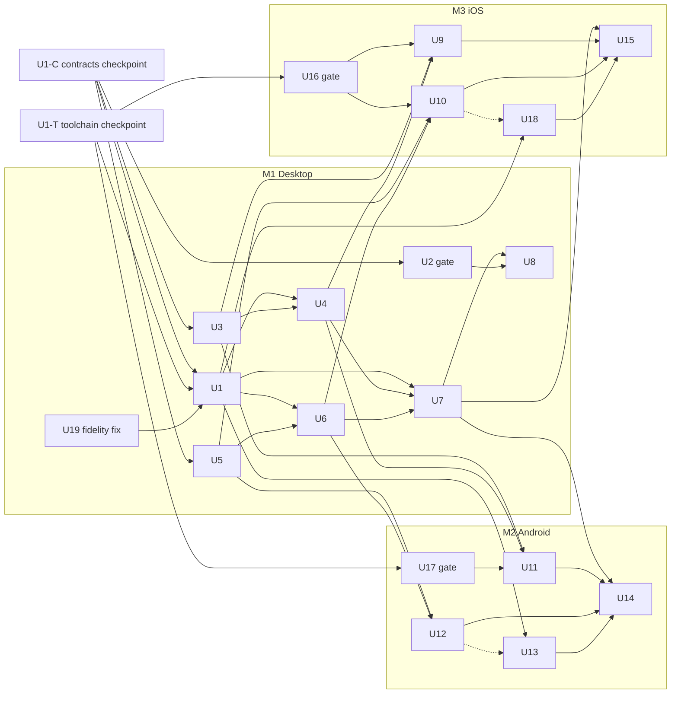
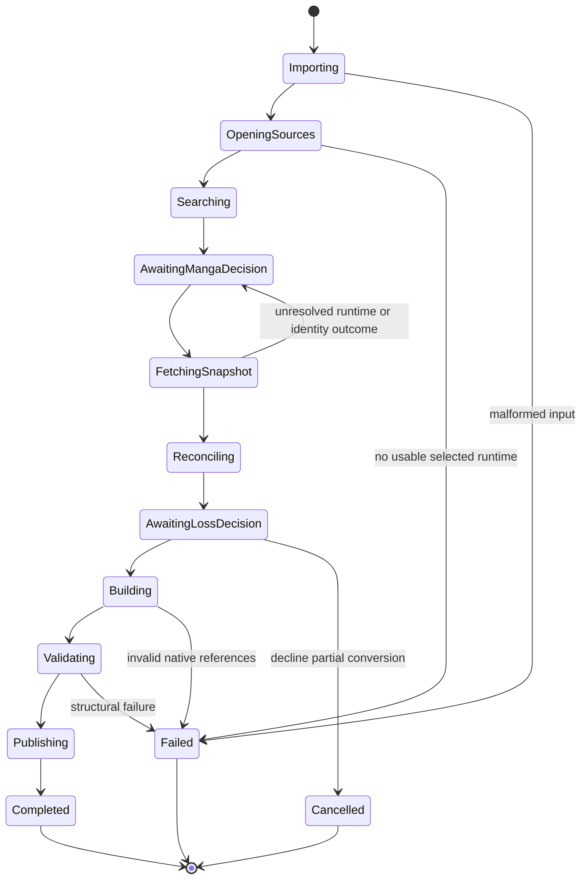
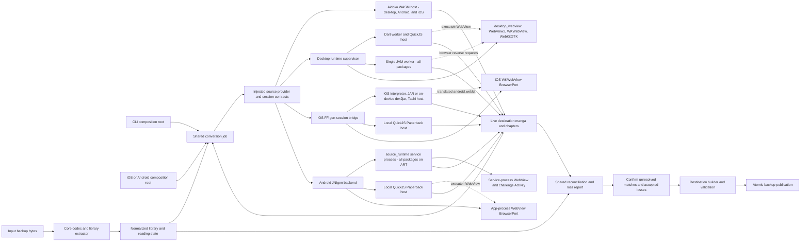
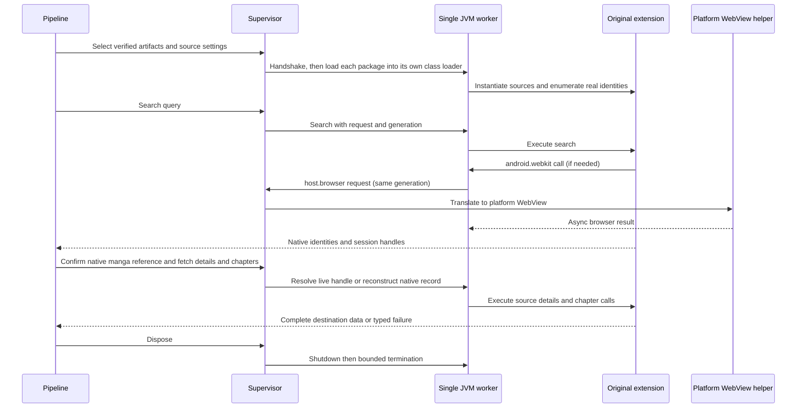
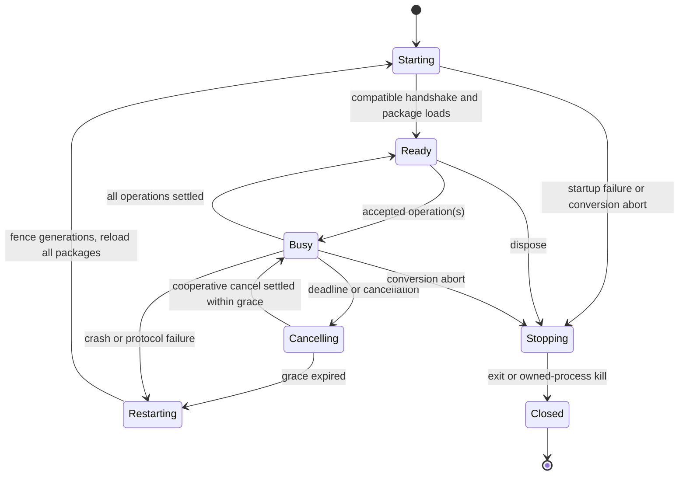
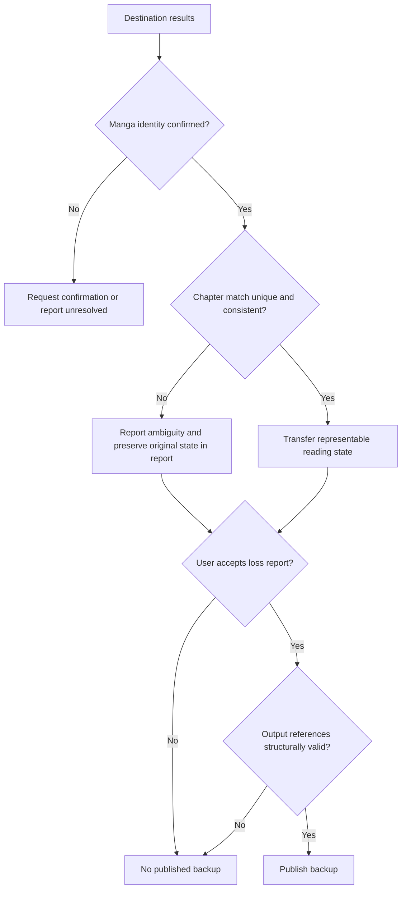

# Paperback and Tachi Source Runners - Plan

## Goal Capsule

**Objective:** Users can move their libraries between Paperback, Aidoku, and Tachi while retaining reading state on manga and chapters that the destination app can actually open.

**Means:** Run destination extensions through the existing Aidoku host, one dedicated Tachi JVM worker that hosts every selected extension package, and a Paperback QuickJS host. Source browser calls are translated to each platform's native WebView. Desktop uses worker processes. iOS and Android use local in-app adapters that call platform code through Flutter 3.50 direct native interop (FFIgen, JNIgen) rather than platform channels (KTD1, KTD2, KTD17, KTD20, KTD23; R13, R15, R17).

**Authority:** Product requirements govern behavior; technical decisions govern implementation within those requirements; units define delivery boundaries. The frontmatter's `execution: code` names the eventual delivery type; this document itself authorizes planning only. Implementation, plugin execution, installations, commits, and publication need a subsequent instruction.

**Execution profile:** Three independently completable milestones (KTD21). The Roadmap under Planning Contract gives the order, early gates, and dependency graph.

- **M1 Desktop** — U19 first (fidelity fixes for existing conversions, releasable on their own), then U1-U8. Ships the CLI on Windows, macOS, and Linux.
- **M2 Android** — feasibility gate U17, then U11-U14.
- **M3 iOS** — feasibility gate U16, then U9, U10, U18, U15.

M2 and M3 deliver embeddable runtimes qualified through in-app harnesses. Users can convert on a phone only after the separate Flutter conversion UI project ships.

U1's contracts checkpoint (U1-C) unblocks both desktop runtime lanes and the desktop browser gate; its toolchain checkpoint (U1-T) unblocks both mobile feasibility gates. Each milestone's largest unknown therefore starts in parallel with desktop work rather than after it. Prove real-source execution early, before completing exporters or distribution. Separate authors may work on the Tachi and Paperback lanes after U1-C. An open gate in one milestone never blocks another milestone's completion. No merge or shipping action is authorized by this document.

**Stop conditions:** Stop the affected lane if a pinned extension cannot execute with the planned host, a destination backup version cannot be restored, or the necessary dependencies cannot be redistributed. Preserve the failing evidence and resolve that prerequisite; do not substitute static mappings, an empty source stub, or a Suwayomi server. A stopped lane blocks its own milestone and every milestone that reuses it. Android and iOS reuse the desktop's shared units (U1, U3-U7), so a stop there blocks them too; a stop in a milestone-specific unit or gate blocks only its own milestone. MangaFire failing its browser path on a platform keeps that platform's milestone open until a workaround passes; a blocked receipt never waives it.

**Upstream breakage:** when a qualification source fails, run the same pinned artifact in its own ecosystem's reference app (Mihon for Tachi, Aidoku or Paperback for theirs). If it fails there too, record the receipt as broken upstream, re-pin to the newest upstream artifact that works in the reference app, and repeat the gate. Upstream breakage keeps the milestone open until the re-pinned source passes, but never stops a lane as a host defect. If no MangaFire artifact passes even in its reference app, record the receipt as site-unavailable and seek an explicit coverage revision that names a replacement browser-challenge source; there is no waiver. This mirrors the Paperback missing-cell rule.

Unobtainable destination app builds or an unavailable disposable restore environment block restore qualification, not the earlier runtime work. Never wipe or replace an existing personal library to clear that gate.

**Completion owner:** Each milestone's implementation owner integrates its runners, verifies that milestone's conversion directions, and reports the distinction between offline tests, live source runs, device runs, and real app restore evidence.

---

## Product Contract

### Summary

Add real Paperback and Tachi source execution to the conversion pipeline on desktop, Android, and iOS. Transfer reading state onto identities returned by the selected destination extension, and report unresolved matches and unrepresentable data before writing a backup.

### Problem Frame

The converter currently runs Aidoku WASM sources, but its Paperback and Tachi loaders return empty catalogs and placeholder implementations. Parsing and serializing backup files therefore does not provide conversion into those ecosystems. The existing Aidoku target also loses partial progress and matches chapters by number alone, so adding source runners without repairing reconciliation would spread those defects.

### Requirements

#### Source execution

- R1. Execute destination extension code to search manga, fetch details, and enumerate chapters; use the extension's returned source, manga, and chapter identities in the output.
- R2. Provide a dedicated desktop Tachi runner without the Suwayomi server, database, GraphQL service, or user interface. One JVM worker process hosts all selected extension packages and repositories for a conversion.
- R3. Run supported Paperback JavaScript bundles using their declared host API version; support the 0.8 and 0.9 API families explicitly rather than treating them as interchangeable.
- R4. Expose extension settings, cookies, language selection, and required host capabilities consistently across search and detail requests within a conversion session.
- R17. Translate source browser use — Tachi sources' `android.webkit` calls and Paperback's `executeInWebView` — to the running platform's native WebView: WebView2 on Windows, WKWebView on macOS and iOS, WebKitGTK on Linux, and Android System WebView on Android. Browser operations a platform WebView cannot express fail with a named capability error.

#### Conversion fidelity

- R5. Support Paperback to Aidoku, Aidoku to Paperback, Paperback to Tachi, Tachi to Paperback, Aidoku to Tachi, and Tachi to Aidoku using the selected destination runtime.
- R6. Preserve library membership, categories, timestamps, bookmarks, completion state, partial progress, and history where the destination can represent them; produce an explicit loss report for unsupported fields, including tracking and hidden-state differences.
- R7. Reconcile chapters conservatively using the live destination list; ambiguous or unmatched chapters must be reported and must not acquire guessed reading state.
- R8. Require manga confirmation when automatic selection is ambiguous; selecting the candidate with the most chapters is not sufficient evidence of identity.

#### Reliability and evidence

- R9. Surface runtime errors, unsupported host methods, missing settings, interaction requirements, deadlines, and cancellation as typed failures; never turn them into successful empty catalogs or chapter lists.
- R10. Keep input backups unchanged, use source-scoped runtime state, and publish output only after validation and completion of the conversion report.
- R11. Validate with MangaDex as a baseline, WeebCentral as an HTML-parsing gate, and MangaFire as a signing/preferences/browser-challenge stress gate; MangaDex alone cannot qualify a runner.
- R12. Bind compatibility claims to the tested app, host API, extension artifact hash, settings, and runtime version. A skipped or blocked source run is not a pass.

#### Mobile execution

- R13. Execute Aidoku WASM sources, Paperback bundles, and Tachi sources locally inside the iOS app, including search, details, and chapter enumeration, without a desktop helper, remote runner, or Suwayomi service.
- R14. Qualify local iOS execution in a signed build on a physical device under ordinary app entitlements; simulator execution, VM startup, or a bridge ping alone does not prove extension compatibility.
- R15. Execute Aidoku WASM sources, original Tachi APK sources on Android ART, and Paperback bundles in local QuickJS inside the Android app, without a desktop helper, remote runner, or Suwayomi service. Build the resulting backup on the Android device through the shared conversion core.
- R18. Keep the iOS build App Store compliant even though it is distributed by sideloading, then TestFlight: extensions run in an interpreter with no JIT, downloaded extensions are data for the app's own runtime and never native code, and the app ships a privacy manifest covering its runtimes. A committed compliance note maps the design to App Store Review Guidelines 2.5.2 and 4.7: interpreted extensions as plug-ins, the native features exposed to them, age-rating handling for extensions rated above the app's rating, and the precedent relied on. Within this plan R18 is checked locally on unsigned builds: interpreter-only execution, no executable memory, no downloaded native code, the privacy manifest, GPL notices, and the guideline note. App Store Connect validation of a distribution-signed build is deferred to the TestFlight setup (Key Decisions). Age-rating handling: extensions rated above the app's rating are hidden by default on every platform until the user enables an age-confirming setting, and the app's own rating stays moderate (Key Decisions).
- R16. Qualify Android source execution for all three ecosystems, verified APK loading, service death/recovery, cancellation, browser interaction, and conversion on a physical ARM64 device. Emulator, class-loading, or bridge-only success is insufficient.

For R5, the first Tachi destination is Mihon. Existing recognized fork inputs continue through their own parsers, with unrepresentable fields reported under R6. Advertising SY, J2K, Yokai, or Neko as additional destination apps requires separate serializer and restore receipts; six conversion directions do not imply every fork is qualified.

### Key Decisions

- **Real extension execution supplies destination identities** (session-settled: user-directed — chosen over cross-app source-mapping tables: the user requires sources to run for conversion). Governs R1, R5, R7.
- **Use a dedicated Tachi host** (session-settled: user-directed — chosen over the entire Suwayomi process: the user rejected that dependency). Governs R2.
- **One JVM worker for all extensions and repositories** (session-settled: user-directed — chosen over one worker per extension package). Governs R2; see KTD1, KTD4, KTD5.
- **Repository JARs and APK-through-dex2jar are equal-weight Tachi artifact paths on desktop and iOS** (session-settled: user-directed — chosen after confirming keiyoushi publishes a signed JVM JAR beside every APK). Use the JAR when the repository publishes one, otherwise convert the APK. Both paths are qualified on every target. Android always loads APK DEX directly. Governs R1, R2, R13; see KTD5, KTD11.
- **Use Flutter 3.50 direct native interop for every mobile platform boundary** (session-settled: user-directed — chosen over platform channels and Pigeon's preview interop mode). Governs R13, R15; see KTD23.
- **Translate source browser use to platform WebViews** (session-settled: user-directed — chosen over failing browser-dependent sources or deferring desktop browser support). Governs R17; see KTD20.
- **Require complex-source coverage** (session-settled: user-directed — chosen over MangaDex-only acceptance: an HTTP API baseline does not exercise the required compatibility surface). Governs R11, R12.
- **Include local iOS execution** (session-settled: user-directed — chosen over deferring iOS or requiring a remote desktop runner: the user explicitly requires iOS-local source execution and named Tachimanga as a released precedent). Governs R13, R14.
- **Include local Android execution, including the Aidoku runner** (session-settled: user-directed). Governs R15, R16.
- **Separate desktop, Android, and iOS milestones** (session-settled: user-directed — chosen over one all-or-nothing delivery). See KTD21.
- **Include the Aidoku runner on iOS** (session-settled: user-approved — chosen over deferring it to follow-up work). M3 qualifies all three ecosystems and all six directions on iOS. Governs R13; see U18, KTD26.
- **MangaFire's browser path must pass on every platform** (session-settled: user-directed — chosen over accepting a named blocked-capability receipt on WebKit platforms). A blocked MangaFire receipt keeps that platform's milestone open; workarounds are spike outputs, not plan decisions. Governs R11, R17; see KTD20.
- **Vendor QuickJS in this repository** (session-settled: user-directed — the user rejected keeping the `BooleanExtra/quickjs-dart` fork; vendoring was chosen over upstreaming its changes to `lindeer/quickjs-dart`). Governs R3; see KTD24. Done in U5: `packages/quickjs/` builds QuickJS-ng from a pinned submodule, and the fork is no longer a dependency.
- **Runtime limits come from per-device performance tests** (session-settled: user-directed — chosen over fixed placeholder values and over a single CI-runner baseline). No limit value ships without benchmark evidence; each runtime sizes its limits for the device it runs on. See KTD25.
- **Android minSdk is 28 (Android 9) for all features** (session-settled: user-directed — confirming U17's recommendation, chosen over single-process WebView confinement on API 26/27). U17 decided it on emulator evidence: on API 26 both processes share one WebView data directory without enforcement, and the pinned extensions already need API 26 and `java.time`. U11 applies it in `android/app/build.gradle.kts`. See KTD19.
- **The iOS app is distributed by sideloading but stays App Store compliant** (session-settled: user-directed — chosen over gating M3 on App Store distribution and over dropping App Store compliance). TestFlight follows once the work is complete and is follow-up work; no App Store or TestFlight review is a gate in this plan, but compliance (R18) is. See KTD11.
- **App Store Connect validation is deferred to the TestFlight setup** (session-settled: user-directed — chosen over uploading a distribution-signed build for validation inside this plan). Until that follow-up, iOS builds stay unsigned and R18 is checked locally: interpreter-only execution, no executable memory, no downloaded native code, the privacy manifest, GPL notices, and the guideline note. Governs R18; see U16, U15.
- **Hide adult-rated extensions by default** (session-settled: user-directed). Extensions whose content rating is above the app's rating are hidden from source selection on every platform until the user enables an age-confirming setting; the app's own rating stays moderate. Governs R18's age-rating handling.
- **Fix existing-conversion fidelity first** (session-settled: user-directed — chosen over keeping those fixes inside U1 behind the rest of M1). U19 ships as its own CLI release.
- **Keep interactive chapter matching** (session-settled: user-approved — chosen over reporting ambiguous chapters only). Users resolve ambiguous chapters and collisions through `SelectionPort` (U1); see KTD7.
- **Retry interrupted work once after a desktop worker restart** (session-settled: user-directed — chosen over failing it with a `worker-restarted` report). The retry count is a fixed rule, not a benchmarked limit. See KTD4.
- **Make mobile conversions recoverable from saved data, not a foreground service** (session-settled: user-directed — chosen over cancelling on screen recreation and over a foreground service). The job lives at app scope and journals its progress; after the system kills the app, relaunch resumes from the journal. See KTD8, KTD18.
- **Accept the GPL risk of the iOS Java runtime and comply fully** (session-settled: user-directed — chosen over a legal-review gate and over searching for a non-GPL runtime). The project is fine shipping GPLv2 code in its apps, including through TestFlight later. See KTD11.
- **Tests never contact a server** (session-settled: user-directed — chosen over live-network tests). A manual capture tool, never run by a test, downloads extension artifacts once and records the sites' responses for the fixed test queries. Captures are committed with each artifact's source URL, SHA-256, and licence, and every test, CI included, replays them offline. Live behaviour is re-checked only by rerunning the capture. Governs R11, R12; see U1.
- **Mobile evidence: emulator and simulator now, physical devices later** (session-settled: user-directed — chosen over changing the physical-device requirement). Device work runs through T3's device tools on the local Android emulator and the Mac's iOS simulators; R14 and R16 still need physical-device receipts before M2 and M3 close.
- **Desktop Java runtime: Amazon Corretto 21** (session-settled: user-directed — chosen over Temurin, Zulu, and Microsoft's build, because Corretto shipped a confirmed Java4Shell fix first). Development and the bundled CLI runtime use Corretto at or above 21.0.13.1. See KTD1.
- **The iOS deployment target follows the runtime** (session-settled: user-approved — chosen over capping it at iOS 15 or 16). U1 reconciles the 12.0/13.0 mismatch now; U16 records the runtime minimum and raises the target to it, and U15 verifies it.

### Scope Boundaries

The delivery covers the desktop CLI on Windows, macOS, and Linux plus embeddable local iOS and Android runtime adapters and integration hosts in the existing Flutter app. The mobile work includes the native source-execution boundary, platform WebView translation, and conversion integration; a complete user-facing Flutter conversion UI remains separate.

No static source correspondence tables, guessed URLs, scraping reimplementations in Dart, source rewrites to make tests pass, or Suwayomi service deployment are included. Desktop JVM execution stays out of process. Local iOS execution requires an embedded runtime and a platform-specific cancellation contract; local Android execution uses ART in a dedicated service process (KTD17/KTD18). The runners load and execute the selected original bundles.

#### Deferred to Follow-Up Work

Web-browser execution of the converter, a remote runner service, and a complete Flutter conversion UI are separate projects. iOS store distribution is follow-up work: the app is sideloaded for now, and TestFlight follows once complete. The build stays App Store compliant throughout (R18).

Desktop browser support is in scope (U2), translated to the operating system's native WebView. A machine with no display or no installed platform WebView returns interaction-required or capability-unavailable failures rather than a bundled browser engine.

### Acceptance Examples

- AE1. Covers R1, R5: An Aidoku library entry converted to Tachi uses the loaded source's exact int64 ID and the manga/chapter URLs returned by that source; refresh in Mihon does not create duplicates.
- AE2. Covers R6, R7: Volume 1 chapter 1 and volume 2 chapter 1 remain distinct, and a partially read chapter retains representable page progress without becoming completed.
- AE3. Covers R7, R9: Two equally plausible destination chapters produce an unresolved match in the report; neither receives transferred read history automatically.
- AE4. Covers R3, R4: A Paperback bundle searches, retrieves manga details, and fetches chapters through its own asynchronous host requests with the same source settings and cookie session.
- AE5. Covers R9, R10: An extension operation in the desktop JVM worker that loops or stops responding is cancelled; if cooperative cancellation fails, the worker is terminated and restarted, every hosted package is rehydrated, no late reply changes a later session, and no partial backup is published. AE8 governs iOS and AE10 governs Android.
- AE6. Covers R11, R12: WeebCentral's live HTML flow and MangaFire's nontrivial host flow both have retained execution evidence. A browser operation the platform WebView cannot express is recorded as a blocked capability rather than claimed compatibility, and a blocked MangaFire run keeps that platform's milestone open.
- AE7. Covers R13, R14: On a signed physical iPhone build with no helper service reachable, the Aidoku, Tachi, and Paperback runners search, fetch details, enumerate chapters, and supply destination-native identities to a conversion. Network requests to the source sites remain necessary.
- AE8. Covers R9, R13: Backgrounding the app, cancelling a search, or expiring an operation cannot publish a late result or leave the main run loop blocked. Native execution cancellation is demonstrated inside the iOS runtime, not simulated by killing a desktop process.
- AE9. Covers R15, R16: A release-profile physical Android build loads a verified original APK factory, reads its exact source identities, runs all three source families (Aidoku, Tachi, Paperback) locally, and completes the six conversion directions with sanitized fixtures while helper services are unavailable. Destination apps remain platform-specific; generating a Paperback/Aidoku backup on Android does not imply those apps run there.
- AE10. Covers R9, R16: A hung Tachi call or service death fences old replies, fails the affected operation, and permits remaining confirmed work after rebind with the same verified artifact/settings. The app remains responsive; no partial output is published.
- AE11. Covers R11, R17: MangaFire's challenge interceptor, which constructs an `android.webkit.WebView` through `keiyoushi.utils.runWebViewBlocking`, completes on each platform: through a translated WebView2/WKWebView/WebKitGTK session on desktop, a translated WKWebView on iOS, and a real WebView created in the Android service process. A failure is reported with its named capability and keeps that platform's milestone open. A visible challenge opens a platform window or Activity and does not count user interaction time against the operation deadline.

---

## Planning Contract

### Current Evidence and Limits

Baseline: `e9964d6c842d3ea8af5c8dbcd21a125b1b04c28b`. The working tree was clean before this plan was added.

Existing integration seams:

- `packages/mangabackupconverter_cli/lib/src/pipeline/plugin_source.dart`: search and details/chapter interface; `mangaKey` is currently the only lookup token.
- `packages/mangabackupconverter_cli/lib/src/pipeline/plugin_loader.dart`: functional Aidoku loader and empty Paperback/Tachi loaders.
- `packages/mangabackupconverter_cli/lib/src/pipeline/extension_entry.dart`, `lib/src/commands/caching_plugin_loader.dart`, and `lib/src/commands/plugin_cache.dart` within the CLI package: catalog and artifact-cache contracts to extend. The current cached byte-loading API returns one source per entry; U4 changes that contract for package factories.
- `packages/mangabackupconverter_cli/lib/src/pipeline/source_manga_data.dart`: normalized data lacks chapter identity and per-chapter progress/history linkage.
- `packages/mangabackupconverter_cli/lib/src/pipeline/target_backup_builder.dart`: Aidoku builder matches completed chapters by number and has a history path that uses the old chapter title as the destination chapter ID.
- `packages/mangabackupconverter_cli/lib/src/formats/paperback/paperback_backup.dart`: byte decoding, library relationships, and progress extraction require characterization.
- `packages/mangabackupconverter_cli/lib/src/proto/`: generated Tachi fork protobuf code. `.github/workflows/update-schemas.yml` regenerates it with `OUTPUT_DIR_PREFIX="packages/mangabackupconverter_cli/lib/src/proto/"`, and `CLAUDE.md` documents that location. KTD14 moves it.
- `packages/aidoku_plugin_loader/lib/src/aidoku/imports/js_imports_native.dart`: existing QuickJS use is a synchronous Aidoku helper, not a complete Paperback host.
- `packages/jsoup_jni/lib/src/jre_manager.dart`: existing JNI infrastructure is reference material only; do not reuse its embedded JVM lifecycle.

**QuickJS dependency.** `quickjs` is the in-repo path package `packages/quickjs/` (KTD24, delivered by U5). Its `native_toolchain_c` hook compiles QuickJS-ng from the `vendor/quickjs` submodule, pinned at `dce8c0bb3b5ddbfbae05c4cd5c1345b05719c0df`, for Windows (MSVC), macOS, Linux, Android arm/arm64/x64, and iOS, and downloads nothing. Android x86 compiles but is not advertised because Flutter 3.50 has no x86 target. When planning began, `quickjs` resolved to the `BooleanExtra/quickjs-dart` fork, whose hook downloaded prebuilt Bellard-derived libraries from a moving `latest` URL; no reference to that fork remains. Detail: Appendix › QuickJS dependency.

**Tachi artifacts.** The live keiyoushi index publishes a signed JVM JAR beside every APK. For WeebCentral, the JAR's certificate matches the repository's published signing fingerprint. Both paths are first-class under KTD5. Detail: Appendix › Tachi artifacts.

**Tachi browser usage.** MangaFire's challenge interceptor builds an `android.webkit.WebView` itself through `keiyoushi.utils.runWebViewBlocking`. It uses observe-only request interception and an asynchronous message bridge. It probes Chromium features by reflection and falls back to `addJavascriptInterface` when those probes fail. Desktop and iOS need a translation layer (KTD20); on Android the real WebView runs in whatever process hosts the extension. Detail: Appendix › Tachi browser usage.

**Flutter direct native interop.** Flutter 3.50 / Dart 3.14 (stable 2026-11-11) makes FFIgen (C, Objective-C) and JNIgen (Java, Kotlin) stable. Calls are synchronous, callbacks are bound to the isolate that created them, and JNI global references are capped at 50,000. CI currently pins Flutter 3.41.1, so U1 upgrades the toolchain. Detail: Appendix › Flutter direct native interop.

The prior read-only audits identified Paperback epoch, library linkage, UTF-8, partial-progress, and duplicate-number defects. Their local archive counts describe one archive, not the format specification. Reproduce each defect with a sanitized fixture before changing behavior. No runner, generated backup, or app restore has been executed as part of planning.

Static inspection of Tachimanga 5.4 build 538 identifies the reference architecture. It translates DEX to JVM bytecode on the device with dex2jar and ASM, then runs `BytecodeEditor.fixAndroidClasses`. It runs an embedded OpenJ9/JDK 17 VM with `-Xint` and `-Djava.compiler=NONE`, plus native network/WebView/QuickJS shims. It embeds a modified Tachidesk server, which remains excluded under R2. The reference VM cannot be recreated after destruction; background/foreground transitions operate on requests and sockets instead. The inspected artifact is the Mac App Store-distributed iOS app, not a physical-iPhone execution receipt. Independent mobile runtime build inputs, safe CPU-loop interruption, and the exact Android bytecode rewrites remain unproven. See `docs/research/2026-11-19-tachimanga-released-runtime-evidence.md` for the artifact hash, trace anchors, provenance, and limits.

**iOS JVM candidates.** No public OpenJ9 iOS port exists. The only public runtime shown running downloaded extension bytecode on a stock iPhone without JIT is the OpenJDK mobile port with HotSpot's Zero interpreter, used by several sideloaded Tachiyomi-extension apps. It has no back-edge safepoint poll, links GPLv2 HotSpot statically, and has no verified App Store shipment. KTD11 targets it. Detail: Appendix › iOS JVM candidates.

Existing iOS seams include `ios/Runner/AppDelegate.swift`, `ios/Runner/Runner-Bridging-Header.h`, `ios/Podfile`, `ios/Runner.xcodeproj/project.pbxproj`, and `integration_test/example_test.dart`. The project deployment target is 12.0 while the Podfile declares 13.0. U1 aligns both to one value (13.0, or Flutter 3.50's minimum if that is higher) during the toolchain upgrade. U16 then records the embedded runtime's minimum and raises the deployment target to it; U15 verifies the shipped value.

Android uses `android/app/build.gradle.kts` (migrated for Flutter 3.50) with minSdk 24, Flutter-provided compile/target SDK versions, Java/Kotlin target 17, and NDK 28.2.13676358; at planning time it was `build.gradle` with minSdk 23 and target 1.8. U17 read the resolved host closure (declared floor 21) and the pinned MangaDex extension (minSdk 26, references `java.time`), and on emulators found that API 26 shares one WebView data directory across processes without enforcement while API 28+ separates them. The app's minSdk therefore becomes 28 for all features (session-settled: user-directed — confirming U17's recommendation); U11 applies it. Evidence: `docs/validation/source-runners/android/README.md`. Android uses its own framework and ART; desktop AndroidCompat classes must not shadow platform `android.*` classes. The Aidoku runtime's native dependencies already target Android: the wasm3 build hook defines `M3_HAS_TAIL_CALL=0` for armv7, and the scraper hook discovers the NDK and cross-compiles. That establishes buildability, not on-device Aidoku source execution (U13).

### Roadmap

Milestones are independently completable (KTD21). Unit IDs are stable, so Implementation Units lists units in execution order, not numeric order.

| Milestone | Units in order | Starts when | Done when |
|---|---|---|---|
| M1 Desktop | U19 and U1 (U1-C, U1-T first) → U2, U3, U5 in parallel → U4, U6 → U7 → U8 | Immediately | Definition of Done › M1 Desktop |
| M2 Android | U17 → U11, U12, U13 → U14 | U17 at U1-T; later units when their shared units land | Definition of Done › M2 Android |
| M3 iOS | U16 → U9, U10, U18 → U15 | U16 at U1-T; later units when their shared units land | Definition of Done › M3 iOS |

#### Early gates

U2, U3, and U5 start when checkpoint U1-C lands; U16 and U17 start when checkpoint U1-T lands. They run in parallel, so each milestone's largest unknown is answered before its implementation effort:

| Gate | Question it answers | If it fails |
|---|---|---|
| U2 spike | Can one helper drive WebView2, WKWebView, and WebKitGTK through `BrowserPort`, and does MangaFire's browser behaviour work on all three? | Replace the helper or find a WebKit workaround before U8; M1 cannot complete until MangaFire passes on every desktop OS. The runtime lanes are unaffected |
| U3 steps 1 and 5 | Does a standalone AndroidCompat closure build and verify both JAR and dex2jar artifacts (step 1), and do the qualification extensions then run on it (step 5)? | Stop the Tachi lane (stop condition) |
| U5 steps 1-2 | Does the vendored QuickJS compile and load for every advertised target, with the existing Aidoku JS tests green after migration? | Stop the Paperback lane until the build is fixed |
| U16 | Can an independently built interpreter-only JVM run on an iPhone, be driven through FFIgen, and interrupt a CPU loop safely? Does MangaFire's browser behaviour work on iOS WKWebView? | M3 blocked with retained evidence; M1 and M2 continue |
| U17 | Can a `:source_runtime` process load real APK DEX from read-only staging, be killed and rebound during a CPU loop, and host WebView alongside the app process (below API 28 resolved by raising minSdk to 28)? | U11 and M2 blocked with retained evidence; U12 and U13 may continue |

#### Dependency graph

Mirrors the units table; a dotted edge is conditional.



#### Critical paths

- **M1:** U1-C → U3 → U4 → U7 → U8, with U8 also waiting on U2's browser helper. U19 ships first; U1's core extraction starts after U19 and must finish before U4, U6, and U7. The Paperback lane (U5 → U6) and the U2 gate run alongside.
- **M2:** U17 → U11 → U14, with U14 also waiting on U7, U12, and U13.
- **M3:** U16 → U9 → U15, with U9 also waiting on U3/U4 and U15 on U7, U10, and U18.

#### Live-source gates by stage

Every stage replays committed captures (Key Decisions). "Live" below means a real extension run against captured site responses; the captures are refreshed only by a manual capture run.

- **In-lane (U3, U6):** MangaDex and WeebCentral search/details/chapters, and MangaFire whenever no browser challenge fires. A challenge reports interaction-required or capability-unavailable against the fake `BrowserPort`.
- **Desktop browser join (U8):** MangaFire's browser path through U2's helper, on each desktop OS.
- **Mobile (U11/U12/U13, U9/U10/U18):** all three qualification sources on device, including MangaFire's browser path on the platform WebView.
- **Qualification (U8, U14, U15):** complete conversions and restores.
- **Upstream breakage:** the re-pin rule under Goal Capsule › Stop conditions applies at every stage.

#### Largest risks and their gates

- Android API coverage and binary/API dependency conflicts: U3 steps 1 and 5.
- Platform WebView semantic gaps: U2 spike, then U8 (desktop), U10 (iOS), U11/U12 (Android).
- MangaFire on WebKit engines, where subresource observation is degraded and Chromium client hints are absent (milestone-blocking): U2 spike on macOS and Linux, U16's WKWebView probe on iOS.
- Limits that do not fit slow devices: per-device benchmarks under KTD25 in U3, U5, U11, U12, U9, and U10.
- Paperback promise and parser behavior: U5/U6.
- Source churn and backup-envelope compatibility: U7, U8.
- The independent iOS runtime build, native interruption (Zero has no back-edge safepoint poll), and App Store compliance of the packaged runtime: U16.
- Security fixes in pinned Java runtimes (Java4Shell, CVE-2026-114938, is the current example): KTD1, KTD11, U8.
- Android process termination and multi-process WebView: U17.

Do not build a generic Android emulator or a general browser subsystem speculatively; the translation targets the APIs the qualification sources actually call.

MangaFire uses signed API requests and a challenge interceptor that constructs an Android WebView. WeebCentral supplies the required HTML/CSS coverage. A challenge-blocked MangaFire result proves failure handling only; its live success gate, and that platform's milestone, remain open until its browser path passes. Availability of all three sites in a particular Paperback API family must be established from real catalog artifacts in U6, with no fabricated substitute. If absent, record the exact missing cell and seek an explicit coverage revision rather than silently removing the complex-source requirement.

### Key Technical Decisions

KTD numbers are stable IDs. Decisions are grouped by topic, so numbers within a group are not sequential.

#### Delivery and toolchain

- KTD21. **Deliver three independently completable milestones, each opened by an early gate.** M1 Desktop (U19, U1-U8), M2 Android (U17, U11-U14), and M3 iOS (U16, U9, U10, U18, U15) each have their own Definition of Done.
  - **Checkpoints:** U1 has two early merge points. U1-C covers the `source_runtime` contracts, including `BrowserPort`, and the desktop supervisor, contract-tested on the current toolchain; it unblocks U2, U3, and U5. U1-T is the Flutter 3.50 / Dart 3.14 upgrade with the existing suites green; it unblocks U16 and U17. Desktop lanes therefore never wait on third-party lint or code-generation support for the new SDK. U1-T must land before M1 is done, and U1's core extraction continues after both.
  - **Feasibility gates:** U16 (iOS runtime build and native interruption) and U17 (Android process, termination, and WebView boundaries) depend only on U1-T and start in parallel with M1. U2's spike is the desktop browser gate. A failed gate blocks its milestone, or its lane, before implementation effort is spent.
  - **Dependencies:** mobile implementation units depend on the shared ecosystem code they reuse (U3-U6, and U1 through them). Mobile qualification units also depend on U7. No mobile unit depends on U2 or U8, and M2 and M3 do not depend on each other.
  - **Shared fixes:** a shared-code change made for one mobile milestone must keep M1's contract tests green.
  - **Blocked milestones:** a milestone whose stop condition fires is reported as blocked with retained evidence. Milestones that do not depend on the blocked unit may still complete; a block in a shared unit (U1, U3-U7) also blocks M2 and M3.
- KTD23. **Use Flutter 3.50 direct native interop at every mobile platform boundary.** The workspace targets Flutter 3.50 / Dart 3.14 or later.
  - **Android:** `source_runtime_android` generates JNIgen bindings (via `tool/jnigen.dart`) for its Kotlin facades: the service client, artifact staging, and app-process WebView `BrowserPort`, plus the `android.webkit`/androidx.webkit classes it drives.
  - **iOS:** `source_runtime_ios` generates FFIgen bindings (via `tool/ffigen.dart`) for the JNI invocation interface, its native dispatcher's C API, WebKit, and any `@objc`-annotated Swift glue.
  - **Paperback and Aidoku:** both remain pure `dart:ffi` users of their existing native libraries.
  - **No message plumbing:** no method channel, event channel, or Pigeon interop-preview layer carries source operations. Pigeon interop mode is excluded until stable.
  - **Rules that apply to all generated bindings:**
    - Calls are synchronous on the calling isolate's thread, so long-running native work is dispatched to owned native/Java threads and completes through listener callbacks.
    - Platform-thread APIs (WebView, Activity) use `runOnPlatformThread`.
    - A native or Java source thread may wait on a native latch that an asynchronous Dart reply signals, as the translated `runWebViewBlocking` does on iOS. The isolate handling that reply must never make a blocking native call into the same chain. No native thread synchronously invokes a Dart callback and waits on an isolate that may itself be blocked in native code; that is the documented cross-runtime deadlock.
    - These waits are native latches signalled through generated listener callbacks; none of them justifies a platform channel.
    - Every JNI or Objective-C wrapper has an explicit owner that calls `release()` or uses `using()`/arenas. Per-session reference counts are bounded well below the 50,000 JNI global-reference limit and asserted in tests.
    - Dart closures capturing native wrappers use `WeakReference` to break cross-GC cycles.
    - Runtime type checks use `.isA()`/`.as()`, never Dart `is`/`as`.
  - **Desktop:** desktop keeps the KTD4 process protocol for the JVM worker by deliberate decision. A shared out-of-process worker is the hard-stop and crash boundary, which an in-process JNI JVM would remove (see the existing `jsoup_jni` VEH-conflict history).
  - **Generated bindings:** they are committed, regenerated by a melos script, and checked for drift in CI.
- KTD24. **Vendor QuickJS as an in-repo package built from source.** Replace the `BooleanExtra/quickjs-dart` git dependency with `packages/quickjs/`, following the `packages/wasm3` pattern. Delivered by U5: QuickJS-ng pinned at `dce8c0bb3b5ddbfbae05c4cd5c1345b05719c0df`, built with MSVC (`/std:c11 /experimental:c11atomics`) on Windows; Android x86 compiles but is not advertised because Flutter 3.50 has no x86 target.
  - **Source:** QuickJS C source as a git submodule pinned to a full commit. Build provenance is that commit; there are no prebuilt downloads, release tags, or digest tables. The pin follows upstream security fixes under KTD1's update rule.
  - **Build:** a `native_toolchain_c` build hook compiles it for every advertised target and registers a bundled `CodeAsset`. Bindings use ffigen `ffi-native` mode and are committed.
  - **Engine:** QuickJS-ng is the expected engine because `native_toolchain_c` uses MSVC on Windows, and the fork's Bellard-derived build needed MinGW there. U5 step 1 confirms by compiling on every target. Choosing Bellard QuickJS instead requires recording the Windows toolchain configuration it needs.
  - **Surface:** the package exposes what the Paperback host needs and neither upstream offers: the interrupt handler, memory and stack limits, and pending-job execution.
  - **Consumers:** the root `pubspec.yaml` and `aidoku_plugin_loader` switch to the path dependency. `js_imports_native.dart` migrates off the fork's `NativeJsEngine`/`NativeEngineManager` with unchanged results. No reference to the fork remains, and `CLAUDE.md`'s quickjs entries are updated.
  - **ABIs:** Android arm64, armv7, and x64; iOS device and simulator; and desktop Windows, macOS, and Linux. U5 records whether Android x86 builds and passes; it is advertised only if it does. The fork's 32-bit ARM fixes are carried over where they still apply.
- KTD25. **Set runtime limits from per-device performance tests, not fixed constants.** Every limit must exist and be bounded, but no value ships without benchmark evidence.
  - **Covered limits:** desktop JVM worker package concurrency, per-operation deadline, cooperative-cancel grace, visible-interaction timeout, and graceful-shutdown bound; QuickJS memory, stack, and interrupt deadlines; Android dispatch deadlines and rebind bounds; iOS interpreter deadlines.
  - **Adaptive sizing:** each runtime derives its limits at startup from the measured capability of the device it runs on, using a sizing rule produced by its benchmark. The rule, its inputs, and the derived values are recorded in the handshake and in qualification receipts.
  - **Benchmark owners:** U3 (desktop JVM worker), U5 (QuickJS), U11 and U12 (Android), U9 and U10 (iOS). Each commits its harness and results. CI runs the desktop benchmarks as a non-gating report that fails only on crashes or missing output, never on timing ranges, because shared runners vary. The committed results are regenerated on reference devices whenever the worker, the QuickJS host, or a sizing rule changes.
  - **Tests:** contract tests use small override values, as U1 already requires. The benchmark output is not invented in this plan.

#### Conversion core

- KTD14. **Extract a reusable pure-Dart conversion core from the CLI.** Create `packages/manga_backup_core/` for the three in-scope portable codecs/models, input normalization, conversion orchestration, reconciliation, reports, and destination builders. It depends on the public contracts in `source_runtime`, never on Flutter, terminal code, concrete source loaders, process launchers, or platform-specific storage. CLI commands and the iOS and Android integration hosts become composition roots and input/output adapters. Move existing behavior incrementally, retaining compatibility exports where existing consumers need them; do not keep a second copy of the conversion engine. Existing native-dependent formats, including Tachimanga's SQLite-backed codec, remain optional registered adapters outside this core. Relocate Tachi-to-Tachimanga convenience conversion out of the portable Tachi model into that legacy adapter so preserving it does not create a reverse dependency on the CLI/native database.
  - **Generated schemas move with their codecs.** Generated Tachi protobuf code moves from `packages/mangabackupconverter_cli/lib/src/proto/` to `packages/manga_backup_core/lib/src/formats/tachi/proto/` in the same change that moves the Tachi codec.
  - **Workflow and docs follow.** In that same change, update `.github/workflows/update-schemas.yml` (`OUTPUT_DIR_PREFIX`), any `build_runner`/`build.yaml` or melos `generate` targets that reference the old path, and the `lib/src/proto/` entry in `CLAUDE.md`.
  - **No legacy path survives.** The workflow must not write to the old path after the move, and no compatibility copy of generated protobuf code remains in the CLI.
- KTD15. **Separate format registration from runtime registration.** Keep the existing sealed `BackupFormat` identities and aliases, but remove concrete native loader construction from those domain objects. A core `FormatRegistry` supplies codecs and writers; an injected `RuntimeRegistry` resolves source providers and platform capabilities. The composition root registers the concrete Aidoku, Paperback, and Tachi backends and their availability. Existing `PluginSource` callers migrate through a temporary adapter to the backend-neutral `SourceSession` contract. A missing runtime capability is a typed failure, never a fallback to a different machine or an empty source list.
- KTD7. **Use one conservative chapter reconciler for all targets.** Retain original source chapter keys, raw numbering, language, volume, all scanlators, title, dates, and progress in normalized data. Exact chapter IDs only establish correspondence within the same verified source identity. Across sources, conflicting known languages or volumes reject a candidate; number and title evidence then narrow candidates, with scanlator as additional evidence. Unknown and sentinel numbers are not shared match keys. Require a unique defensible match or user confirmation, and enforce destination uniqueness across the complete assignment: multiple state-bearing source chapters claiming one destination chapter form an unresolved collision, not an implicit merge. Do not transfer state for that collision until it is explicitly resolved. Do not introduce an arbitrary weighted similarity score as a substitute for ambiguity handling.
- KTD8. **Treat loss and uncertainty as conversion output.** The report accounts for each selected manga, source chapter carrying state, tracking record, and unsupported field as transferred, explicitly excluded, unrepresentable, or unresolved. A user may explicitly accept a partial conversion; the pipeline never silently drops those records. Unattended CLI runs accept a partial conversion only through an explicit `--accept-partial` flag; without it they publish nothing and report why. The target builder consumes reconciliation results and cannot independently guess chapter matches. Output is written to a temporary sibling and atomically published only after structural validation and report acceptance.
  - **Conversion journal:** the core records each completed step: input backup identity, selected sources with artifact and settings revisions, confirmed native references with their confirmed destination snapshots, user decisions, and the accepted loss report. A platform I/O adapter persists it. Secrets are never journaled (KTD9), so resuming may ask for them again. On resume, sources reopen, confirmations rehydrate from their durable native references (KTD3), confirmed snapshots are reused rather than re-fetched (only manga without one are fetched), and a changed artifact or settings revision reopens the affected decisions. Publication stays atomic, so a killed conversion never leaves partial output.

#### Source runtime boundary (all platforms)

- KTD3. **Share a runtime transport and lifecycle, not ecosystem internals.** Add a `source_runtime` Dart package with protocol DTOs, backend-neutral source sessions, capabilities, errors, the browser port contract (KTD20), and desktop process supervision. Keep ecosystem adapters compatible with the pure-Dart `PluginSource` conversion boundary so the Flutter integration hosts can use them without a CLI process. Confirmations retain a serializable native reference bound to the verified artifact, source identity, and settings revision. For Tachi this preserves the source-returned `SManga` fields needed by subsequent calls; Paperback retains its native manga ID and source-returned context. A worker may cache the live object behind an opaque session handle, but that handle is never the only identity retained by the pipeline. Source IDs cross JSON as decimal strings, preserving values beyond JavaScript's exact integer range. After restart, reconstruct from the native record or re-fetch by its exact native identity; if source-specific state cannot be reconstructed, report an unresolved stale-session failure instead of guessing a replacement.
- KTD12. **Separate logical runtime sessions from OS processes.** The shared contract unit owns a backend-neutral session interface. Desktop adapters use KTD4's process protocol and termination. Android adapters use KTD18's bound-service transport, reached from Dart through JNIgen bindings. iOS adapters dispatch through FFIgen bindings to owned runtime threads (KTD23). Generation fencing and durable references are common to all three.
  - **iOS JNI ownership:** JNI calls attach only when required, use bounded local frames, preserve the correct package class loader, and release native strings/handles through an explicit owner. Source-session cleanup does not destroy the process-wide VM.
  - **iOS backgrounding:** on app backgrounding, reject new work, bound or cancel host requests, fence late callbacks, and resume eligible sessions after foregrounding without restarting the VM.
  - **iOS deadlines:** deadlines, sized under KTD25, must interrupt interpreter execution at safe checkpoints and bound every network/JS/WebView host wait without blocking the main run loop. A Dart timeout, isolate cancellation, Java thread interruption, or dropping a reply alone is not execution termination.
  - **iOS qualification gate:** U16 proves interpreter interruption before M3 implementation. If the runtime cannot demonstrate bounded cancellation for source code and host calls, the local backend fails its qualification gate. Do not substitute unsafe thread termination or app termination. A native runtime crash can terminate the app, so process-level crash isolation is not claimed on iOS.
  - **Android:** KTD18 governs.
- KTD16. **Keep Flutter dependencies outside the shared Dart packages.** `source_runtime` and the common Aidoku/Tachi/Paperback provider packages expose Dart contracts and injected backend ports without a Flutter SDK dependency. `packages/source_runtime_ios/` and `packages/source_runtime_android/` are the Flutter/native integration packages for their platform's Tachi runtime, native session bridge, and browser port implementation. Under KTD23 they are FFI/JNI packages with generated bindings and native build inputs, not method-channel plugins. Their typed execution ports live in `source_runtime`, so neither plugin depends on a concrete Dart source loader or the conversion core. The Flutter composition root injects those implementations into the common providers. Importing only a contract entry point would not prevent a transitive Flutter dependency if the same package manifest declared one, so the package boundary is explicit.
- KTD9. **Use process separation for ownership and crash control, not as a sandbox claim.** JVM extension code runs with the worker user's privileges. Packages in the shared worker are not isolated from one another beyond class-loader namespaces; each still receives only its own source-scoped state directory, settings, and cookie jar through host APIs. The worker receives only the selected source artifacts, source-scoped state directories, and the request data, with a scrubbed environment. It does not need backup paths. Heap bounds and QuickJS interrupts reduce runaway execution but do not establish an OS security boundary. The CLI has no established secure-storage adapter, so cookies, passwords, tokens, and secure-state values are session-only in this delivery. Runtime restarts within a conversion restore that state from the supervising process's memory; session close erases it. Ordinary non-secret preferences may persist in a source-scoped directory, except Tachi extension `SharedPreferences`: extensions keep passwords and tokens there beside ordinary settings, so in this delivery they are session-memory only, seeded from each conversion's chosen settings snapshot. Worker and helper diagnostics pass through a redaction filter before reaching any user log (U1). Neither worker output nor validation receipts may persist secret state under the guise of settings or diagnostics.

#### Ecosystem hosts and browser (all platforms)

- KTD5. **Repository JARs and APK-through-dex2jar are equal-weight Tachi artifact paths.** Record repository URL, package, API range, artifact version, SHA-256, artifact kind, and trusted signing identity.
  - **Selection:** use the repository's JVM JAR when its index publishes one, and the APK through dex2jar otherwise. A repository-level or per-artifact override can force either path. Both paths are implemented, tested, and qualified on desktop and iOS; neither is a fallback.
  - **JAR path:** verify the JAR signature (`META-INF` signature block and per-entry digests) against the repository's trusted signing identity before class loading. Every non-signature entry must be listed in the signed manifest and verify against that one signer; a JAR with unsigned, extra, or mixed-signer entries is rejected, because standard JAR verification silently ignores unsigned entries. Resources and `AndroidManifest.xml` are read from the JAR.
  - **APK path:** verify APK signatures with pinned `apksig` against the same trusted identity, then convert DEX to JVM bytecode with pinned `dex2jar`, preserving resources and source classes. Verification precedes conversion or class loading.
  - **Trust identity:** a JAR and an APK share a trust identity only when both certificates match the repository's published fingerprint, as verified for keiyoushi. Otherwise each artifact kind records its own signer. A JAR never silently inherits an APK's signer.
  - **Trust anchor:** the first time a repository is added, its published signing fingerprint is stored in a local trust store after the user approves it; the qualification manifest pins keiyoushi's. Each run compares the published fingerprint with the stored one, and a mismatch blocks admission until the user approves again. A fingerprint read beside the artifacts proves consistency, not provenance. The approval goes through `SelectionPort`; unattended CLI runs and mobile harnesses refuse admission with a typed trust failure unless the fingerprint is already stored or pre-approved by an explicit manifest or flag.
  - **Patching:** any Android bytecode patching required after conversion, or for published JARs, is applied identically to both paths and versioned in the cache identity.
  - **Pins:** U3 selects compatible versions, checks licenses, and proves the minimal artifact path before its live gate.
  - **Cache:** cache identity includes original digest, converter version, and host compatibility version. Verified bytes are privately staged so the digest checked is the artifact actually loaded.
  - **Loading:** all packages load into the single KTD1 worker. Each package gets a child-first class loader with parent-owned host APIs to avoid duplicate API types. Disposing a package releases its loader for class unloading; metaspace and heap are bounded and reported. Do not reconstruct source IDs from display names.
  - **Loader contract:** U4 models a package entry whose byte-loading method returns a list of sources hosted by the shared worker. The wrapper cache and all existing loader implementations adopt that return contract, with Aidoku yielding a singleton list.
- KTD2. **Put the Paperback host in a new `paperback_plugin_loader` package.** Own one QuickJS runtime per source worker isolate; a desktop Dart worker process provides a hard-stop boundary for native hangs and crashes. Add any missing QuickJS C API surface to the vendored package (KTD24); do not patch the pub cache. The process/isolate separation preserves Aidoku's existing synchronous JS behavior.
- KTD6. **Implement Paperback 0.8 and 0.9 as explicit host adapters.** Verify each real catalog layout and bundle entry point before selecting it. Bind the selected repository/bundle trust decision to an artifact digest and API family; reject changed bytes before execution, including cache hits. Use authenticated upstream signatures or a trusted pinned artifact digest where available; a digest fetched beside an unauthenticated bundle proves consistency, not provenance. Cache and load the verified immutable bytes, not a mutable URL or filename. Run pending QuickJS jobs, create promises for asynchronous Dart callbacks, and resolve or reject them only on the owning runtime thread. Supply API-appropriate networking, interceptors, binary responses, cookies, timers, state, and parser globals. Bundle pinned Cheerio and required JavaScript polyfills rather than assuming a Rust CSS parser is a drop-in substitute. `executeInWebView` routes through the KTD20 browser port; only an operation the platform WebView cannot express throws a capability error. No Node `fs`, process access, or QuickJS `std`/`os` module is exposed to source code.
- KTD20. **Translate source browser use to the platform's native WebView through one `BrowserPort` contract.** `source_runtime` defines `BrowserPort`: open a source-scoped session, load URL or HTML with base URL, evaluate script, register a message handler, read and write cookies, set user agent, show for interaction, and close. Each operation is asynchronous, cancellable, and generation-fenced.
  - **Allowed schemes:** load-URL, navigation, redirect, and base-URL values are limited to http and https, plus `about:blank` and `loadData` content with an http(s) base URL. `file:` and other local or app-custom schemes are rejected with a named capability error at the port and in each platform's navigation delegate, so sandboxed Paperback and Aidoku sources cannot read local files through a browser.
  - **Browser storage:** each session uses an ephemeral store where the platform has one. Otherwise (Android without multi-profile, or a desktop fallback) the implementation deletes that source's cookies and web storage at session close, and fails the browser capability if it cannot confirm the deletion (KTD9). Implementations that use a persistent store also wipe all source browser data when the helper or app process starts, before opening any session, so a crash or a killed app cannot leave it behind.
  - **Desktop and iOS (Java kernel):** the Tachi host kernel supplies an `android.webkit` translation shim. It covers `WebView`, `WebViewClient`, `WebChromeClient`, `WebSettings`, `CookieManager`, `JavascriptInterface`, and `WebResourceRequest`/`WebResourceResponse`. It also covers the `Handler`/`Looper` main-thread semantics, `android.view`/`android.graphics` overlay classes, and the foreground-activity check that `keiyoushi.utils.runWebViewBlocking` assumes.
    - **Feature probes:** `keiyoushi.webview.internal.WebViewGlueBridge` detects features by reflecting into Chromium's private `org.chromium.support_lib_glue` through `WebView.getWebViewClassLoader()` (or `getFactory` below API 28), and reports every feature unsupported if that fails. The shim deliberately supplies a provider class loader with no Chromium glue, so every probe resolves to unsupported. The helper then takes its documented fallback: `addJavascriptInterface` with `void postMessage`, script injection at page start, and no client-hint override. MangaFire is qualified on that path; emulating Chromium's private boundary protocol is out of scope.
    - **Scope:** the shim targets the surface used by the helper and the qualification sources, not the whole Android API.
    - **Forwarding:** it forwards to `BrowserPort` through KTD4 reverse requests on desktop and the native bridge on iOS.
  - **Desktop platform WebViews:** the supervisor implements `BrowserPort` with a pinned native helper that wraps WebView2 on Windows, WKWebView on macOS, and WebKitGTK on Linux. The proposed implementation is a standalone helper executable over the `wry`/`tao` Rust crates. It must be its own program: macOS requires the AppKit event loop on the process main thread, and the repository's cargo build hooks only produce dynamic-library code assets. A committed cargo build script builds it for Windows, macOS (arm64, x64), and Linux, and the CLI locates it through the runtime artifact manifest. U2's spike confirms or replaces that choice before U8's browser join.
  - **iOS:** `source_runtime_ios` implements `BrowserPort` with `WKWebView` (KTD13).
  - **Android:** no translation is needed for Tachi, which uses real WebView in the service process (KTD19). The app-process implementation serves Paperback.
  - **Paperback on every platform:** `executeInWebView` calls the same `BrowserPort`.
  - **Request interception has two tiers:**
    - **Observe-only:** the handler returns `null`, as MangaFire's does to read `sec-ch-ua*` headers. WebView2's `WebResourceRequested` supports it. WKWebView and WebKitGTK cannot observe http(s) subresource requests, and WebKit engines do not send Chromium client hints at all. There, the shim delivers main-frame navigations it can see, and records "subresource observation unavailable" as a degraded capability in the receipt rather than a hard failure, because the request still proceeds unchanged. MangaFire must still succeed on these engines (Key Decisions). If the degradation breaks it, the U2 spike (macOS, Linux) or U16's WKWebView probe (iOS) must find a workaround; the workaround mechanism is a spike output, not a decision in this plan.
    - **Replace:** the handler returns a response. It is supported only where the platform can substitute responses (WebView2), and is a named capability error elsewhere.
  - **Other gaps:** synchronous `@JavascriptInterface` return values cannot be emulated over asynchronous platform message handlers, and are a named error. None of the qualification sources' observed calls need them. A missing display, or a missing installed platform WebView runtime, returns interaction-required or capability-unavailable.
  - **Visible challenges:** a visible challenge opens a platform window (desktop), presented view controller (iOS), or Activity (Android). The CLI TUI shows a waiting state and does not draw over the window.
  - **No bundled browser:** no bundled Chromium or browser engine is introduced.

#### Desktop

- KTD1. **Own one small Kotlin/JVM worker process for all extension packages, speaking a private stdio protocol.** Use JRE 21 as the initial desktop toolchain and a locked Gradle dependency graph. Bundle Amazon Corretto 21 at or above 21.0.13.1, the Java4Shell fix (CVE-2026-114938: Base64-decoder memory corruption on x86-64 CPUs with AVX-512 VBMI, reachable from site-supplied Base64). The worker refuses to start on a JRE below its recorded security floor. The bundled JRE and the host's Java libraries track Oracle's quarterly and out-of-band security releases, and the floor is raised with each. The same rule covers the vendored QuickJS submodule (KTD24) and the Android host dependency lock (KTD17): a security fix affecting an advertised target bumps the pin, and qualification receipts record the security baseline. Reuse or extract the narrowly required Android compatibility classes and source API implementations from pinned upstream code with their licenses; do not pull in Suwayomi's server module. Early dependency tracing determines whether AndroidCompat can be consumed independently or needs a small attributed extraction. A conversion starts at most one worker. It loads every selected package from every selected repository into its own child-first class loader, while host API types stay parent-owned. This is one worker implementation, not a second server. Implements R2 (session-settled: user-directed — one worker for all extensions/repos).
- KTD4. **Use bounded, bidirectional frames and generation-fenced sessions.** Protocol version 1 uses UTF-8 JSON lines on stdin/stdout with a maximum encoded frame size of 16 MiB. Logs use stderr only.
  - **Operations:** handshake, artifact preparation, package load/unload, settings, search, details-with-chapters, dispose, and shutdown. Capabilities describe supported API versions and browser needs.
  - **Reverse requests:** the worker sends supervisor-bound `host.browser.*` requests for KTD20 translations. They carry their own request IDs and the originating operation's generation, and late or orphaned replies are discarded. Each envelope carries a request ID and session generation.
  - **Concurrency:** one call runs at a time per extension package; different sources from the same Tachi factory share that serialization boundary. Different packages may execute concurrently on a bounded worker thread pool sized per device under KTD25.
  - **Deadlines:** every operation has a deadline measured from dispatch, adjustable explicitly for qualification. Time spent waiting on a visible user browser interaction is excluded and bounded separately. KTD25 sets both values.
  - **Frame limit:** large chapter responses fail visibly at the limit rather than truncating.
  - **Abandonment:** abandoning a UI subscription removes its queued requests and discards an in-flight reply without disturbing the worker. Queued interactive searches coalesce to the newest query.
  - **Deadline escalation:** first cancel cooperatively — interrupt the executing thread, cancel its OkHttp calls and browser sessions — and allow a bounded grace period (KTD25). If the operation does not settle, terminate and restart the single worker; that is the only hard-stop boundary on desktop.
  - **Restart:** a restart fences every generation, reports the operation that hit the deadline as failed (never silently retried), and reloads every hosted package from its verified artifact. It rehydrates confirmations through KTD3 references. Other packages' in-flight operations are reported as `worker-restarted` and re-queued once, a fixed rule; the report records each re-queue. Source operations only read data, so one repeat is safe.
  - **Shutdown and ownership:** explicit conversion abort terminates the worker after a bounded graceful shutdown (KTD25). A conversion-scoped asynchronous owner is created before loading and registers the worker immediately. It is awaited in a finally block covering loading through publication.
- KTD10. **Qualify desktop artifacts and file-format versions explicitly.** Pin dependency and source revisions before implementation. `.pas4` V4 support is a separate claim from a Paperback 0.9 runtime API claim. Confirm the destination app can restore that backup envelope before enabling it. Existing Aidoku fixtures predate current upstream source code; match host ABI to each artifact rather than assuming an update is compatible.

#### Android

- KTD17. **Run Tachi APK DEX directly on Android ART through a private bound service.** Add `source_runtime_android`, a Flutter/native plugin depending on the same pure-Dart backend ports as the iOS plugin.
  - **Service process:** a non-exported, same-UID service in a dedicated `:source_runtime` process owns every Tachi package class loader and source call, mirroring KTD1's single desktop worker. This contains crashes and provides a restart boundary, not a privilege sandbox.
  - **Host dependencies:** use an Android-compatible host module with pinned source API, Kotlin, networking, preferences and QuickJS dependencies. Share platform-neutral source-host logic with U3, but exclude desktop AndroidCompat stubs, the KTD20 `android.webkit` translation shim, JVM launch code, dex2jar and iOS bytecode rewriting from the Android dependency graph.
  - **Admission:** verify the APK signing identity and digest before admission, parse its manifest/resources, load its original `classes.dex` with a compatible package class loader, and enumerate the actual factory. Keep host API types parent-owned and prove source dependency resolution.
  - **Inputs:** an ordinary JVM-only repository JAR is not Android DEX input; select a verified APK of the requested version or fail admission. No package-manager installation of each extension is required.
- KTD18. **Own Android IPC, recovery and browser lifecycle explicitly.**
  - **Dart boundary:** the app-process Dart backend calls a small Kotlin client facade (bind, dispatch, cancel, kill, descriptor read) through JNIgen bindings (KTD23). Service replies and death notifications reach Dart as listener callbacks; no Binder thread waits on a Dart callback.
  - **Transport:** Binder carries bounded control messages. Larger snapshots use bounded read-only file descriptors with length/digest validation and explicit close/unlink ownership, not the desktop 16 MiB JSON frame as one Binder transaction. Keep the 16 MiB logical response limit unless explicitly revised.
  - **Deadlines:** a dispatch deadline, sized under KTD25, fails its operation and cooperatively cancels host calls. An unresponsive service is terminated by killing the app's own `:source_runtime` process using the PID it reported at bind time, and its death is observed through the binder death notification before rebinding. The same-UID, non-exported binding is the trust boundary (KTD17), so no separate authentication is needed. U17 proves this path for a CPU loop before M2 implementation; if it cannot be proven, M2 is blocked. Only the dedicated worker is terminated, never the Flutter app.
  - **Recovery:** service death invalidates its generations and caches. Durable native references and supervisor-held session state rehydrate all affected packages for remaining work. Do not silently retry the failed operation. Because the single service owns every package, a restart affects every hosted session and must be reported.
  - **Abandonment:** UI abandonment discards replies without killing the worker.
  - **Lifecycle:** the first delivery is foreground, user-driven conversion. Backgrounding pauses new work, bounds active work and fences callbacks; there is no foreground service. The job lives at app scope in Dart, so the manifest's handled configuration changes never touch it. If the system kills the app, relaunch resumes from the KTD8 conversion journal without duplicate publication.
- KTD19. **Reuse the Paperback host on Android and put each WebView in the process that needs it.**
  - **Paperback:** U12 runs U5/U6's common QuickJS promise/API/parser implementation in an app-owned worker isolate with native interrupt and memory limits, using KTD24's vendored QuickJS built for each advertised ABI. It does not duplicate the host in Kotlin or assume the Tachi service hosts Dart. Paperback `executeInWebView` runs on a WebView in the app process, driven from Dart through JNIgen bindings to `android.webkit` and androidx.webkit (KTD23).
  - **Tachi:** Tachi extensions construct real `android.webkit.WebView` instances themselves inside the `:source_runtime` service process. That process therefore owns a main looper and an initialized WebView. It calls `WebView.setDataDirectorySuffix` before its first WebView. That call does not exist below API 28, where Android does not support WebView in more than one process of an app, so the app's minSdk is 28 for all features (session-settled: user-directed — confirming U17's recommendation, chosen over single-process confinement on API 26/27). U17 decided it on emulator evidence (API 26 shared one WebView data directory across both processes; the pinned extensions need API 26 and `java.time`), and U11 applies it in `android/app/build.gradle.kts`. No single-process confinement path is built. A challenge Activity declared with `android:process=":source_runtime"` hosts visible challenges in the same process.
  - **Isolation:** source-scoped cookie and storage separation uses the androidx.webkit multi-profile API where the installed WebView supports it. Where it does not, source isolation for browser state is unavailable and is reported as a capability failure rather than claimed. Tachi's service-process WebViews do not go through `BrowserPort`, so the service applies KTD20's storage rule itself: at session close and on service restart it deletes the source's cookies and web storage (its profile, or all service-process WebView data without multi-profile), and fails the browser capability if it cannot confirm the deletion (KTD9).
  - **Interaction:** interactive challenges require a visible Activity and return interaction-required while unavailable. Bind callbacks to source/session generation and account revision. Browser waits are bounded and cancelled when the job or worker dies.
  - **Cancellation:** Paperback CPU-loop cancellation is qualified separately from Tachi service termination.
- KTD22. **Run the existing Aidoku host on Android as a qualified runtime.** U13 runs `aidoku_plugin_loader` in the Android app's worker isolate using the wasm3 interpreter and the Rust scraper HTML backend already routed for Android. It exposes Aidoku through the same `SourceProvider`/`SourceSession` contracts as on desktop. Its WebView imports, currently failure stubs, route through the app-process `BrowserPort` where a qualification source requires them; otherwise they remain named capability failures. No WASM behavior or postcard ABI is forked for Android.

#### iOS

- KTD11. **Use an embedded interpreter-only JVM with a direct native operation bridge on iOS, and support both artifact paths on the device.** Tachimanga's inspected OpenJ9/JDK 17 startup establishes this reference mechanism; it does not establish a reusable mobile SDK.
  - **Runtime candidate:** no public OpenJ9 iOS port exists; OpenJ9's maintainers defer to OpenJDK. The candidate is the OpenJDK mobile port (`openjdk/mobile`) built for iOS with HotSpot's Zero interpreter as a static `libjvm`. It is pinned to a known-good commit and community patch set, because building from HEAD currently fails to link. Several sideloaded Tachiyomi-extension apps run it on device; no verified App Store build does. Detail: Appendix › iOS JVM candidates.
  - **Runtime build gate:** U16 builds it reproducibly from pinned public source and proves it on a physical iPhone. If it fails, try the same VM with a different pin or patch set before any other engine. The other engines found (GraalVM Espresso, CheerpJ) lack iOS evidence or need a paid licence and are not planned candidates. Do not copy the closed SDK or silently switch execution models.
  - **Interruption:** current Zero polls safepoints only at method return, so a call-free loop stalls garbage collection and handshakes. U16 measures two mechanisms and selects one: deadline checks that the on-device bytecode rewrite pass injects into extension loop back-edges on both artifact paths, and a small back-edge poll patch to Zero. The selected mechanism must also stop loops in parent-owned host libraries and the JDK class library (for example jsoup parsing or `java.util.regex` backtracking on site text), and must keep firing when extension code catches the deadline exception and continues. Injected checks therefore also rewrite the host libraries and packaged class library at build time and re-fire on every back-edge after the deadline. The Zero poll patch needs a named delivery path, such as JVMTI `StopThread` compiled into the static `libjvm` with `can_signal_thread`.
  - **Licensing and distribution:** the app is sideloaded, then distributed through TestFlight once complete, and stays App Store compliant (R18). HotSpot is GPLv2 without the Classpath exception and is linked statically; the project accepts that risk (Key Decisions) and complies fully, shipping the GPL notices and a written offer of the corresponding source, including the patch set. Compliance needs the modular image with the module-path patch, because exploded module directories reportedly fail App Store Connect validation, and a privacy manifest covering the runtime's required-reason APIs.
  - **Security updates:** the `openjdk/mobile` pin is on the JDK 26 line, which receives no upstream security fixes. U16 records a procedure for moving the patch set to a newer commit, and security fixes are applied or backported whenever they affect the iOS build. Java4Shell (CVE-2026-114938) does not affect it: the flaw needs x86-64 intrinsics, and Zero on ARM64 has none.
  - **Artifact path:** repository JARs are signature-verified, then pass through the same rewrite pass as converted APKs (Android patching and any deadline checks U16 selected) before loading. APKs are verified and converted with the same pinned `apksig`/`dex2jar` code inside the embedded VM, as the reference app does. Rewritten and converted JARs are cached by KTD5 identity, including the rewrite version, so each runs once per artifact. Both paths are qualified on the device under KTD5.
  - **Native boundary:** Dart drives the VM through FFIgen-generated C bindings to the JNI invocation interface and a small native dispatcher (KTD23). There is no platform channel or Swift message layer between the Dart backend and the VM.
  - **Shared host code:** share Java source-host code only at a class-file/library level supported by both desktop and mobile builds; desktop JRE 21 does not imply compatibility with the mobile class library, which is JDK 26-level at the current pin and lacks removed APIs such as `Thread.stop`.
  - **Dispatch:** use a direct native dispatcher, not the reference app's loopback Tachidesk/Javalin/Jetty stack.
  - **VM lifetime:** keep one VM for the app process lifetime, with per-package class loaders and replaceable logical source sessions; never call destroy/recreate as a recovery strategy. Preserve native references across those session resets.
  - Implements R13 (session-settled: user-directed — chosen over an iOS client of a remote desktop runner: source execution must remain local).
- KTD13. **Embed Paperback QuickJS locally on iOS and supply iOS browser services through KTD20.** Reuse U5/U6's promise bridge, pinned parser assets, and versioned API adapters in a worker isolate without launching a Dart subprocess. Package KTD24's vendored QuickJS built for iPhoneOS and the simulator, with recorded build hashes and signing/linkage checks. The iOS browser port implementation drives a main-thread `WKWebView` for both Paperback `executeInWebView` and the Tachi `android.webkit` translation. It calls WebKit directly from Dart through FFIgen Objective-C bindings, in the way `package:cupertino_http` wraps `NSURLSession`. Navigation and script-message delegates are Dart-implemented protocols using listener callbacks, and main-thread work uses `runOnPlatformThread`. It delivers asynchronous results, browser-session cookies, user agent, and cancellation through a session-owned bridge. Scope browser data to the source with a per-source non-persistent `WKWebsiteDataStore`, and do not block the main queue on a synchronous interpreter callback. Source code stays unchanged; an unsupported browser method fails with its named capability rather than returning an empty value.
- KTD26. **Run the existing Aidoku host on iOS as a qualified runtime.** U18 runs `aidoku_plugin_loader` in an app worker isolate using the wasm3 interpreter, the SwiftSoup HTML backend already routed for iOS, and the GCD `WasmSemaphore` backend. It exposes Aidoku through the same `SourceProvider`/`SourceSession` contracts as on desktop and Android. Its WebView imports route through U10's WKWebView `BrowserPort` only where a qualification source requires them; otherwise they remain named capability failures. No WASM behavior or postcard ABI is forked for iOS.

### High-Level Technical Design

#### Module boundaries

Dependencies point from applications to contracts and implementations. A source loader never imports the conversion core, and the core never imports a source loader. Existing format models and their generated schemas move with their owning codecs; their public behavior remains covered during extraction.

| Module | Owns | Depends on | Must not own |
|---|---|---|---|
| `manga_backup_core` | Codecs, generated format schemas, normalized library/state, conversion job, reconciliation, builders, loss report | `source_runtime` public contracts, pure-Dart format dependencies | Flutter widgets, terminals, JVM/QuickJS launch, HTTP scraping |
| `source_runtime` | Shared source DTOs, provider/session interfaces, `BrowserPort`, artifact cache/leases, capability/error contracts, desktop supervisor and injectable backend ports | Dart and pure-Dart infrastructure dependencies | Flutter SDK, backup schemas, read-state transfer rules, concrete ecosystem implementations |
| `quickjs` | Vendored QuickJS source, build hook, and ffigen bindings (KTD24) | `native_toolchain_c`, `ffi` | Source host APIs, Paperback adapters |
| `desktop_webview` | Desktop `BrowserPort` client and standalone helper executable over WebView2/WKWebView/WebKitGTK | Pinned native WebView bindings | Source execution, backup logic |
| `aidoku_plugin_loader` | Existing WASM execution plus a source-contract adapter on desktop, Android, and iOS | `source_runtime`, existing WASM/parser engines | Backup writing or migration decisions |
| `paperback_plugin_loader` | Catalogs, bundle admission, API 0.8/0.9 host, QuickJS embedding | `source_runtime`, vendored `quickjs` package and pinned parser assets | Manga/chapter reconciliation or backup construction |
| `tachi_plugin_loader` | Catalog/package admission, source factory enumeration, desktop/iOS/Android host adapters | `source_runtime`, native bridge or JVM worker protocol | UI, server/database stack, backup schemas |
| `source_runtime_ios` | FFIgen-bound native integration, app-scoped JVM owner, iOS backend implementations, WKWebView `BrowserPort` | `source_runtime` execution ports, Flutter 3.50, `objective_c`, Apple frameworks | Backup parsing/writing, concrete Dart source loaders, migration decisions, terminal code |
| `source_runtime_android` | JNIgen-bound native integration, `:source_runtime` ART service, Binder transport, Android backend, service-process WebView/challenge Activity, app-process `BrowserPort` | `source_runtime` execution ports, Flutter 3.50, `jni`, Android SDK | Backup parsing/writing, concrete Dart loaders, desktop JVM or server stack |
| `tools/tachi-source-runner` | Java source-host kernel, `android.webkit` translation shim, desktop stdio launcher, platform-neutral host logic and separate Android/iOS build targets | Locked JVM/API/compatibility dependencies | Flutter, migration workflow, Tachidesk web service |
| CLI package and Flutter application | Runtime composition, user decisions, input/output access, progress rendering | Core and concrete source providers | Duplicated parsing, matching, or source implementations |

The `source_runtime` public contract library imports no subprocess implementation or concrete native engine, and its package manifest has no Flutter dependency. Desktop process supervision, `source_runtime_android` dispatch, and `source_runtime_ios` dispatch are selected explicitly by each composition root. `BackupFormat` describes a file format; it does not choose how an extension executes.

#### Contracts and ownership

These are responsibility-level contracts, not final Dart signatures. U1 owns the source DTOs/interfaces, the `BrowserPort` contract, and the core library/conversion types; U2 owns the desktop `BrowserPort` implementation. Each interface has one implementation owner per platform and meaningful contract tests.

| Contract | Input and output | Owner and failure boundary |
|---|---|---|
| `BackupCodec` | Backup bytes and format hint to a format-native document; native document to bytes | Core format module; malformed or unsupported envelopes fail parsing |
| `LibraryExtractor` | Format-native document to normalized library plus extraction losses | Core format module; retains native chapter provenance and missing-value distinctions |
| `ArtifactStore` | Selected repository/package/version to verified immutable artifact and compatibility metadata | Ecosystem loader, using shared artifact contracts; failed trust/integrity never reaches execution |
| `ArtifactCache` | Content digest and producer/profile identity to privately staged immutable bytes | Shared runtime infrastructure; ecosystems supply their own signature/API verifier, while hashing, cache integrity, and byte leases have one implementation |
| `SourceProvider` | Repository discovery and verified package opening to enumerated source sessions | Ecosystem loader; a factory package may expose multiple source identities |
| `SourceSession` | Search query/page/cursor, settings snapshot, or native manga reference to results or a complete manga snapshot | Runtime adapter; serializes calls at the package boundary and returns typed failures |
| `BrowserPort` | Source-scoped browser session requests to asynchronous page, script, cookie, and interaction outcomes | Platform adapter (desktop helper, iOS WKWebView, Android app-process WebView); unsupported semantics return named capability failures |
| `SelectionPort` | Source choices, repository trust (a first-seen or changed signing fingerprint), manga candidates, chapter ambiguities, or a loss report to explicit decisions | CLI or app adapter; core never reads terminal keys or presents native UI |
| `ChapterReconciler` | Input chapter state, immutable destination snapshot, and explicit overrides to correspondence and unresolved items | Pure core function under KTD7; no network or source calls |
| `TargetBackupBuilder` | Accepted correspondence, metadata, and destination-native identities to a format-native document | Core writer; cannot search or invent missing destination references |
| `OutputTransaction` | Validated bytes and private conversion report to staged/published output | Platform I/O adapter; failure leaves the prior destination untouched under R10 |

`SourceSession` operations return a typed outcome. A successful empty result is distinct from timeout, unsupported API, interaction required, stale reference, artifact incompatibility, worker restart, or source failure. Search retains ecosystem-specific pagination metadata as bounded opaque data; it is not forced into a page number when the source uses a cursor. Capability discovery covers the requested operation and host API family, not a promise that every method in the ecosystem works.

The artifact lease owns verified bytes and any prepared JAR. The package lease owns one class loader inside the shared runtime: the desktop JVM worker, the Android `:source_runtime` service, or the iOS VM. Source-session leases borrow package resources. The conversion job owns those leases, its operation queue, and (on desktop) the single worker lease. The application-level iOS VM owner and the Android service binding outlive individual conversion jobs. Closing the final source lease of a package releases its class loader after in-flight callbacks settle; it does not destroy the iOS VM or unbind the Android service while other packages remain.

#### Data and identity model

The core retains the imported library separately from the fetched destination data. No imported source-native URL is silently repurposed as a destination-native URL.

- `InputLibrary` contains library membership, ordered categories, manga metadata, chapter identities and state, history, tracking, and extraction-loss records. Raw numbering/date values remain available beside interpreted values where a sentinel or schema ambiguity matters.
- `SourceIdentity` contains ecosystem and the identity enumerated by the running source, plus the verified package/artifact binding. Repository package ID, runtime source ID, native manga/chapter ID, and ephemeral session handle are separate fields.
- `NativeMangaRef` contains the exact source-returned identity and serializable context under KTD3. Its settings revision is durable and secret-free: a digest over allowlisted non-secret settings keys (the Evidence Identity allowlist) plus the names, never the values, of the secret keys supplied. Re-entering secrets for the same keys after a restart keeps the revision, so a resumed conversion keeps its confirmations.
- `DestinationSnapshot` contains fetched manga metadata and a complete, immutable chapter list, bound to the native reference, artifact, settings revision, and fetch outcome. A failed or incomplete fetch cannot masquerade as an empty complete list.
- `ReconciliationPlan` records accepted input-to-destination chapter correspondence, its evidence, user overrides, collisions, and unmatched state. Builders consume it without rematching.
- `ConversionDraft` contains destination-native document data and an accounting report. `ConversionResult` contains published output identity, complete/accepted-partial outcome, and the private report; failure or cancellation publishes neither.

Snapshots prevent a source refresh or settings change during confirmation from silently changing what the builder writes. A changed source artifact or settings revision invalidates its affected snapshot and requires re-fetch/reconfirmation. Exact identities may be rehydrated after a compatible session reset; stale in-memory handles may not.

The settings revision tracks explicit configuration/account changes; routine cookie or token renewal within the same session does not invalidate every search result. A destination format that uses a narrower identity than the runtime contract, such as only a numeric source ID, must reject conflicting package/source bindings before building a backup rather than silently collapse them.

#### Conversion job and application integration

CLI commands load input bytes and construct `ConversionJob` with the format registry, runtime registry, selection port, progress observer, and output transaction. The Flutter composition root constructs the same job with local iOS or Android providers and app-local I/O. Neither entry point imports the other's command/presentation layer.

The first mobile host on each platform is a testable application service and integration harness, not a complete conversion screen. Its physical-device test must parse the input backup, run the selected local source, reconcile state, build and validate the destination backup, and publish the test output inside the app sandbox. Supplying IDs to a backup built on another machine does not satisfy that test.



Every nonterminal job state also accepts explicit cancellation. The job fences its operation generation immediately, cancels owned work, and awaits platform cleanup before finishing cancellation. KTD4, KTD12, and KTD18 define what actual execution interruption means on desktop, iOS, and Android. Per-source failures remain in the report even when another source succeeds; they do not disappear when a search UI closes.

#### Platform execution and host kernel

The Java host kernel consists of extension verification/preparation (JAR signature verification, or apksig plus dex2jar, on desktop and iOS), package class loading, source-factory enumeration, source operation dispatch, settings/cookie access, host API shims, and the KTD20 `android.webkit` translation shim. The desktop stdio launcher and iOS JNI dispatcher both call that kernel. The Android service reuses only the kernel's platform-neutral dispatch, settings, and identity logic; it runs on the real Android framework and excludes the shims and dex2jar. Shared source-host code targets the common class-file/library surface established by U9, with platform implementations injected for services that differ.

On desktop, one JVM worker hosts every selected package and speaks KTD4's bounded bidirectional protocol. The Paperback Dart worker owns its source QuickJS runtimes and implements KTD6. Aidoku continues through its existing WASM host. Browser reverse requests from the JVM worker and `executeInWebView` calls from the Paperback worker both reach the supervisor's `desktop_webview` helper. The parent job controls lifetimes through the common provider/session contracts.

On Android, the Dart backend reaches the `:source_runtime` service through JNIgen bindings to a Kotlin client facade. The service hosts every Tachi package on ART and owns the service-process WebView and challenge Activity. Paperback and Aidoku run in app-process worker isolates. Paperback browser calls, and Aidoku browser calls where they are qualified, use the app-process `BrowserPort`.

On iOS, an application-scoped VM owner initializes the interpreter once. Dart reaches the VM through FFIgen bindings to the JNI invocation interface and a native dispatcher. Each conversion opens logical package/source sessions in that VM, and native calls execute on owned background threads with the appropriate JNI attachment and class loader. Objective-C/Swift services handle the platform work; WKWebView operations run on the main queue and complete asynchronously. The independent native bridge owns its buffers and Java/global/native references explicitly. It does not reuse Tachimanga's proprietary `jl_*` bridge or loopback server.

Paperback runs a local QuickJS runtime in its worker isolate on every platform. Its promise bridge schedules host work, resolves or rejects on the owning engine thread, and drains jobs fairly. Host completion, cancellation, and native deadline state are synchronized independently of the Dart isolate's event loop, so a busy interpreter cannot conceal a deadline merely by preventing another Dart message.

The iOS runtime must qualify KTD12's interruption contract. Static `-Xint` evidence is not proof of a safe per-operation CPU budget. A poisoned engine/session is fenced and reported unavailable; the architecture never promises recovery by destroying and recreating the app VM. Process-level crash containment is available on desktop (worker process) and Android (service process), not iOS.

#### Storage and publication

Separate verified artifact cache, source-scoped non-secret preferences, conversion-local snapshots, and output transactions. Secrets remain session-only under KTD9. There is no server dependency in this delivery. Mobile hosts persist a conversion journal (KTD8) in app storage so a conversion survives the system killing the app.

Desktop publication stages a validated file beside its final destination. The iOS and Android integration hosts commit inside app-controlled storage and export the completed immutable file through their platform adapters; an external document provider is not assumed to offer atomic replacement. Unsupported output semantics fail before claiming R10. Private user conversion reports may describe that user's unresolved titles/state; committed qualification evidence follows the stricter redaction contract in Evidence Identity.

Component and data flow:



Runtime interaction sequence (desktop):



Worker lifecycle (desktop single JVM worker):



Match and publication decisions:



The worker sequence and state machine above describe the desktop process generation. On Android, the same transitions apply to the `:source_runtime` service under KTD18, with rebind replacing process restart. On iOS, session transitions use KTD12's native interruption and cleanup contract rather than spawning or killing processes.

Prose requirements govern any disagreement with these diagrams.

### Output Structure

New paths below are proposed additions, not existing infrastructure:

```text
packages/manga_backup_core/           Portable codecs, conversion job and builders
  lib/manga_backup_core.dart          Public conversion API
  lib/src/formats/                    Format models, schemas and codecs
  lib/src/formats/tachi/proto/        Generated Tachi fork protobuf code (moved from CLI)
  lib/src/conversion/                 Job, selection/I-O ports and reports
  lib/src/reconciliation/             Pure chapter/state correspondence
packages/source_runtime/              Dart protocol, supervision, BrowserPort, test worker
  lib/source_contracts.dart           Backend-neutral source and browser DTOs/interfaces
  lib/src/backends/                   Desktop supervision and typed backend ports
packages/desktop_webview/             Desktop BrowserPort helper (WebView2/WKWebView/WebKitGTK)
packages/tachi_plugin_loader/         Dart catalog and JVM adapter
packages/quickjs/                     Vendored QuickJS submodule, build hook, ffigen bindings
packages/paperback_plugin_loader/     QuickJS host, API adapters, worker
packages/source_runtime_android/      Flutter/native integration and injected backends
  android/src/main/                   :source_runtime service, IPC, source host, WebViews
  lib/src/                            Android adapters implementing shared backend ports
packages/source_runtime_ios/          Flutter/native integration and injected backends
  ios/Classes/Tachi/                  Local JVM bridge and ownership
  ios/Classes/WebView/                WKWebView BrowserPort
  lib/src/                            iOS backend adapters for common providers
tools/tachi-source-runner/            Kotlin JVM worker, android.webkit shim, Gradle build
integration_test/support/             Per-platform on-device conversion harnesses
docs/source-runners.md                Setup, supported versions, capabilities
```

---

## Implementation Units

Units are listed in implementation order across all three milestones; each heading names its milestone. Units in the same wave can run in parallel. Done criteria per milestone: Definition of Done.

1. **Wave 0:** U19 (M1, its own CLI release) and U1 (M1). U1's checkpoints U1-C (contracts) and U1-T (Flutter 3.50 toolchain) merge first; its core extraction follows U19.
2. **Wave 1, from the checkpoints:** U2, U3, and U5 (M1) start at U1-C; the U17 (M2) and U16 (M3) feasibility gates start at U1-T.
3. **Wave 2:** U4 (Tachi catalog, after U3) and U6 (Paperback host, after U5), both M1.
4. **Wave 3, runtimes:** U7 (M1); U11, U12, and U13 (M2); U9, U10, and U18 (M3). U13 and U18 may start as soon as U1 lands; they are listed after U12 and U10 because they use those browser ports when a qualification source needs browser imports.
5. **Wave 4, qualification:** U8 (M1), U14 (M2), and U15 (M3).

| Unit | Milestone | Outcome | Primary files | Depends on |
|---|---|---|---|---|
| U19 | M1 | Fidelity fixes for existing conversions, released first: Paperback parsing, chapter reconciliation, Aidoku-target reading state | CLI pipeline, Paperback format, new reconciler | None |
| U1 | M1 | Source and `BrowserPort` contracts with desktop supervision (U1-C), Flutter 3.50 toolchain (U1-T), then the portable core, reporting, and interactive chapter confirmation | `packages/source_runtime/`, `packages/manga_backup_core/`, CLI compatibility layer, schema workflow, CI toolchain pin | U19 (extraction only) |
| U2 | M1 | Early gate, then build: desktop platform WebViews behind `BrowserPort` | `packages/desktop_webview/` | U1-C |
| U3 | M1 | Single desktop JVM worker, JAR and dex2jar artifact paths, `android.webkit` translation (fake port in-lane) | `tools/tachi-source-runner/` | U1-C |
| U5 | M1 | Vendored QuickJS and async embedding | `packages/quickjs/`, `packages/paperback_plugin_loader/lib/src/runtime/` | U1-C |
| U17 | M2 | Early gate: Android process, staging, termination, and multi-process WebView boundaries over JNIgen | `packages/source_runtime_android/` skeleton, gate harness | U1-T |
| U16 | M3 | Early gate: OpenJDK mobile Zero build, FFIgen JNI invocation, native interruption, WKWebView probe, App Store compliance | `tools/tachi-source-runner/ios/`, `packages/source_runtime_ios/` skeleton, gate harness | U1-T |
| U4 | M1 | Tachi catalog, package cache, and adapter | `packages/tachi_plugin_loader/` | U1, U3 |
| U6 | M1 | Versioned Paperback host APIs (fake port in-lane) | `packages/paperback_plugin_loader/` | U1, U5 |
| U7 | M1 | Native destination backups and composition | Core builders and conversion pipeline | U1, U4, U6 |
| U11 | M2 | Local Android Tachi ART service and service-process WebView over JNIgen | `source_runtime_android`, Android host build target | U3, U4, U17 |
| U12 | M2 | Local Android Paperback and app-process `BrowserPort` | Common Paperback host, `source_runtime_android` | U5, U6 |
| U13 | M2 | Aidoku runner on Android | `aidoku_plugin_loader` Android path, `source_runtime_android` composition | U1, U12 (only if browser imports are required) |
| U9 | M3 | Local iOS Tachi runtime (JAR and on-device dex2jar) over FFIgen | `source_runtime_ios`, Tachi host packaging | U3, U4, U16 |
| U10 | M3 | Local iOS Paperback and WKWebView `BrowserPort` | Paperback runtime and `source_runtime_ios` | U5, U6, U16 |
| U18 | M3 | Aidoku runner on iOS | `aidoku_plugin_loader` iOS path, `source_runtime_ios` composition | U1, U10 (only if browser imports are required) |
| U8 | M1 | Desktop browser join, packaging, live source and restore qualification | CI, packaging, CLI integration tests | U2, U7 |
| U14 | M2 | Android on-device conversion qualification | Android integration tests, packaging | U7, U11, U12, U13 |
| U15 | M3 | iOS on-device conversion qualification | iOS integration tests, packaging | U7, U9, U10, U18 |

### U19. Fix existing-conversion fidelity first (M1, separate release)

**Goal:** Stop today's conversions losing reading state, before any runner work. The existing Aidoku target matches chapters by number alone, drops partial progress, and writes history against the old chapter title. The Paperback parser misreads dates, text encoding, and library links. U19 fixes these in the current CLI package so they can ship as their own CLI release.

**Requirements:** R6, R7, R8; KTD7; AE2, AE3. **Dependencies:** None. Runs on the current toolchain, in parallel with U1's checkpoints; U1's core extraction moves its result.

**Files:**
- CLI package: `lib/src/pipeline/{source_manga_data,target_backup_builder}.dart`, `lib/src/formats/paperback/paperback_backup.dart`, the Paperback date mapper under `lib/src/common/`, a new `lib/src/reconciliation/chapter_reconciler.dart`, the chapter-count auto-confirmation in `lib/src/commands/migration_dashboard.dart`, and the non-interactive match fallback in `lib/src/commands/convert_command.dart`.
- Tests: `test/reconciliation/chapter_reconciler_test.dart`, `test/pipeline/{source_manga_data_entries,target_backup_builder}_test.dart`, `test/formats/paperback/paperback_backup_test.dart`, and `test/common/date_time_mappers_test.dart`, with sanitized characterization fixtures.

**Approach:**

1. **Characterize first.** Add characterization fixtures for the audited Paperback and Aidoku-target failures, with anonymized relationships and values rather than the private full archive. Confirm each repaired case fails before its fix.
2. **Paperback date and encoding fixes.** Introduce a Paperback-specific Apple-reference-date codec after confirming the archive contract; preserve the Unix-seconds codec for other callers. Classify date sentinels explicitly and use UTF-8 decoding at the archive boundary.
3. **Library traversal.** Traverse actual library references through primary source and manga info; retain non-library metadata separately. Preserve tab order and source-specific chapter provenance.
4. **Chapter identity and reconciliation.** Add chapter identity and per-chapter progress/history linkage to `SourceMangaData`. Implement KTD7's conservative reconciler, and replace the Aidoku builder's independent number lookup and old-title history reference with its output. Ambiguous chapters and collisions receive no state and are listed in the conversion summary; U1 later adds interactive resolution and KTD8's full accounting.
5. **Manga confirmation.** Remove chapter-count-based automatic confirmation for ambiguous manga candidates per R8. The non-interactive fallback, which takes the first search result when no title matches exactly, instead accepts only a single exact-title match across plugins and otherwise leaves the manga unresolved in the summary.

**Release:** U19 is an independently releasable increment, so the CLI with these fixes can ship before the rest of M1. Merging and releasing still need an instruction.

**Test scenarios:**

- Library ID differs from manga-info ID but primary-source references link correctly; only library manga are selected by default.
- Apple-reference timestamp, missing-date sentinels, Unicode tabs and chapter titles survive parsing and serialization without changing Unix callers.
- Covers AE2: partial progress, bookmarks, and per-chapter read dates survive a unique match.
- Covers AE3: duplicated chapter numbers, conflicting volumes/languages, unknown `-1`, and multiple scanlators do not cause fan-out read assignments.
- Two different source chapters each select the same unique destination candidate; the global collision remains unresolved and neither reading state is silently merged or overwritten.
- Existing history references a source chapter by ID; every emitted destination history record references a fetched destination chapter.
- A non-interactive run with no unique exact-title match leaves the manga unresolved instead of taking the first result.
- The existing CLI conversion and pipeline suites stay green apart from the intentionally repaired cases.

**Verification:** Run `flutter test packages/mangabackupconverter_cli/test --reporter expanded`. The repaired cases fail before their fixes and pass after. No runner or restore claim follows from these tests.

### U1. Establish source contracts, desktop supervision, and the portable conversion core (M1)

**Goal:** Give every runner a tested transport, cancellation boundary, capability contract, and browser port, then extract the portable conversion core with its loss-aware normalized model, complete reporting, and interactive chapter confirmation. Its early merge points deliver the contracts (U1-C), which unblock the desktop lanes, and the toolchain upgrade (U1-T), which unblocks the mobile gates.

**Requirements:** R4, R6-R10, R12; KTD3, KTD4, KTD7, KTD8, KTD9, KTD14, KTD15, KTD20, KTD23; AE3, AE5. **Dependencies:** U19 (before step 3, the core extraction); none for checkpoints U1-C and U1-T.

**Files:**
- `packages/source_runtime/`: `pubspec.yaml`, `lib/source_contracts.dart`, explicit backend entry points in `lib/source_runtime.dart`, and `lib/src/{protocol,worker_supervisor,runtime_session,runtime_error,artifact_cache,browser_port}.dart`. Tests: `test/worker_supervisor_test.dart`, `test/protocol_test.dart`, `test/artifact_cache_test.dart`, `test/browser_port_contract_test.dart` (a reusable suite every platform implementation runs), `test/fixtures/fake_worker.dart`, and `test/fixtures/fake_browser_port.dart`.
- `packages/manga_backup_core/`: `pubspec.yaml`, `lib/manga_backup_core.dart`, `lib/src/{formats,conversion,reconciliation}/` (including `conversion/conversion_journal.dart`), and `lib/src/formats/tachi/proto/`. Move the selected format models/schemas, generated protobuf code, normalized data, builders, and orchestration from the CLI. Tests, including U19's suites moved from the CLI: `test/reconciliation/chapter_reconciler_test.dart`, `test/conversion/source_manga_data_entries_test.dart`, `test/conversion/target_backup_builder_test.dart`, `test/formats/paperback/paperback_backup_test.dart`, and `test/common/date_time_mappers_test.dart`.
- CLI package: `lib/src/pipeline/{plugin_source,migration_pipeline}.dart`, `lib/src/commands/{live_search_select,migration_dashboard}.dart`, compatibility exports/adapters, and retained integration tests.
- Repository root:
  - `.github/workflows/update-schemas.yml` output path, and any codegen config referencing `lib/src/proto/`.
  - The Flutter version pin in `.github/workflows/*.yml` (3.41.1 → 3.50.x).
  - SDK constraints (Dart `^3.14`) in workspace manifests.
  - `CLAUDE.md` (proto path and CI Flutter version).
  - `ios/Runner.xcodeproj/project.pbxproj` and `ios/Podfile`, aligned to one iOS deployment target.

Keep native-dependent legacy codec/direct-conversion adapters outside the portable core under KTD14.

**Approach:**

1. **Toolchain (checkpoint U1-T).** Upgrade the workspace and CI to Flutter 3.50 / Dart 3.14 (KTD23), in parallel with step 2, and run the full existing test, lint, and format suites on the new toolchain. Regressions from the upgrade are fixed or recorded here, not mixed into later units. The existing `ffigen` users (wasm3, swiftsoup) regenerate cleanly or keep their pinned generator. Align the Xcode project (12.0) and Podfile (13.0) deployment targets to one value: 13.0, or Flutter 3.50's minimum if that is higher.
2. **Contracts (checkpoint U1-C).** Create `source_runtime` with KTD3/KTD4/KTD9: backend-neutral `SourceProvider`/`SourceSession`, typed outcomes, native references, artifact cache, and the desktop supervisor with injected process launch. The supervisor manages one shared JVM worker plus the Paperback Dart worker. Do not make Aidoku speak an external process protocol. `source_runtime` imports no core library or backup model. Define `BrowserPort` under KTD20: operations, allowed schemes, storage cleanup, typed outcomes (completed, cancelled, interaction-required, capability-unavailable with the named operation, navigation failure), source-scoped session identity, generation fencing, a fake implementation, and the reusable contract suite. Include KTD4's reverse-request framing for `host.browser.*`. Extend the existing Aidoku package with a source-contract adapter over its current loader, so Aidoku satisfies the same injected runtime boundary the new ecosystems will. Define the capture format and replay contract: every host HTTP layer and `BrowserPort` implementation has a replay mode that serves committed captures and fails any request without one, and a record mode used only by `tool/capture_source_fixtures.dart`, a manual tool no test runs. Captures live under `fixtures/source_captures/<ecosystem>/<source>/` with each artifact's source URL, SHA-256, and licence. Convert the existing live-network Aidoku tests to replay. Worker and helper stderr, and any HTTP or browser trace, pass through a redaction filter before the CLI log sink. It strips `Cookie`, `Set-Cookie`, and `Authorization` values, credential URL components, and the session's secret values (KTD9).
3. **Extract.** Once U19 has merged, create `manga_backup_core` and move the existing codecs, models, and orchestration, including U19's reconciler and fixes, without changing their behavior. Move the generated protobuf code and update `update-schemas.yml`, codegen config, and `CLAUDE.md` in the same change (KTD14).
4. **Single edit pass over shared CLI files.** Extend search results, confirmation callbacks, and detail calls to carry native references rather than handle-only strings. Wire the asynchronous conversion owner into `migration_pipeline.dart` before loading begins, and await close in its encompassing finally block. Then move the pipeline into the core. `migration_dashboard.dart` and `live_search_select.dart` are edited once for the native-reference and typed-failure changes together; U19 already landed the R8 change, so there are no separate competing edits.
5. **Reporting and chapter confirmation.** Implement KTD8's complete accounting over U19's reconciler. Add chapter-ambiguity decisions to `SelectionPort` so the user can resolve unresolved chapters and collisions (KTD7). Propagate all scanlator values, while keeping output-format constraints in the loss report.
6. **Typed outcomes.** Make the shared details outcome distinguish success, empty-but-successful data, and typed failure.
   - Translate existing Aidoku null/error outcomes into that failure contract.
   - Preserve load/search/detail errors in the conversion report instead of keeping a match confirmed without fetched chapters.
   - Carry search failures through both selection UIs into final accounting, including a successful result from one source alongside another source's failure.

**Checkpoints:** U1-C (step 2) and U1-T (step 1) merge first, each with its tests passing. U2, U3, and U5 depend on U1-C; U16 and U17 depend on U1-T. Steps 3-6 follow U19 and must finish before U4, U6, and U7.

**Patterns:** Existing Aidoku session ownership and typed error propagation (avoid its known one-shot port/hang failure patterns); existing format-specific mappers and `SourceMangaData` extraction. Start with characterization coverage before extraction and failing regressions before changing parser behavior. Replace terminal-oriented `verbosePrint` behavior with structured diagnostics rendered by the CLI adapter.

**Test scenarios:**

- Split UTF-8 frames and multiple frames per read retain exact content and source IDs beyond 2^53.
- Unknown protocol version, malformed/oversized frame, wrong generation, unexpected stdout text, and an orphaned reverse request fail the session visibly.
- The fake `BrowserPort` passes the reusable contract suite, and a late callback after a generation change never resolves a newer request.
- The reusable contract suite refuses a `file://` load, a redirect to `file://`, and a `file://` base URL, and finds no cookies or web storage left after a session closes or after a mid-session kill and restart, on every implementation.
- Seeded cookies, tokens, and passwords in worker stderr never appear in the user log file.
- A test that issues a network request with no matching capture fails, in every host HTTP layer; no test reaches a server.
- Covers AE5 at the supervisor level, using the fake worker:
  - Cancellation during startup, mid-request, and shutdown never leaks a process, including a startup that completes after cancellation.
  - A deadline first attempts cooperative cancel. Expiry of the grace period restarts the single worker and reloads all packages, and no old handle works in a new generation.
- Previously confirmed native references remain usable after restart with the same artifact/settings snapshot. The timed-out operation is marked failed. Other packages' in-flight operations are re-queued once and recorded as `worker-restarted`; a second restart reports them as failed. Queued detail calls resume without queue-wait time consuming their execution deadlines.
- Repeated debounced queries remove obsolete queued searches and discard an obsolete in-flight reply without restarting the worker or invalidating other confirmed manga.
- Calls to one package serialize while two different packages execute concurrently within the pool bound, and logs cannot corrupt protocol replies.
- One package loads successfully before a second package fails; the pipeline awaits worker cleanup before returning the failure.
- Two providers request the same admitted artifact bytes; shared cache integrity/staging preserves a digest-bound lease, while each provider still performs its ecosystem-specific trust/API admission.
- A conversion journal written partway through resumes after a simulated restart: decisions and confirmations survive, secrets do not, a resume in a new process with secrets re-entered for the same keys keeps every confirmation, and a changed non-secret setting reopens the affected decisions.
- A user resolves an unresolved chapter and a collision through `SelectionPort`; only the chosen correspondence receives state, and the decision is recorded in the report.
- Aidoku detail lookup returns null or fails after a manga is selected; the conversion report records the runtime failure, and no successful chapter reconciliation is inferred from missing data.
- One source searches successfully while another requires interaction; both the dashboard and live search retain the failure reason through partial-conversion acceptance.
- The core public API performs a fixture-backed conversion with injected source/selection/output adapters and no CLI presentation or concrete runtime dependency.
- Regenerating Tachi protobuf code through the updated workflow script writes only to the core path, and the moved codec's tests pass against it.
- The existing suites pass on Flutter 3.50 / Dart 3.14 in CI at checkpoint U1-T.

**Verification:** Actual fake subprocess runs prove cleanup and framing; mocked launches alone are insufficient. Resource caps are tested with small override values. The moved `packages/manga_backup_core/test/` suites and retained CLI integration suites demonstrate both preservation and explicit unresolved outcomes. No live runner or restore claim follows from these tests.

### U2. Prove and build desktop platform WebViews (M1 early gate)

**Goal:** Prove early that one helper can drive WebView2, WKWebView, and WebKitGTK through U1's `BrowserPort` contract, then build the desktop implementation that U8 joins to both ecosystems.

**Requirements:** R9, R11, R17; KTD20; AE11. **Dependencies:** U1-C. Runs in parallel with the runtime lanes; its spike result is due before U8.

**Files:**
- `packages/desktop_webview/`: the helper executable's Rust source and pinned `Cargo.lock`, a committed build script (`tool/build_helper.dart`) that U2's tests and U8's packaging both run, a Dart client that speaks a bounded stdio protocol and locates the binary through the runtime artifact manifest, and `test/` with platform smoke tests.
- `docs/source-runners.md` for the per-platform WebView capability matrix.

**Approach:**

1. **Spike, then decide.** Prove the proposed `wry`/`tao` helper on Windows (WebView2), macOS (WKWebView), and Linux (WebKitGTK): load a page, evaluate script, round-trip a message handler, read cookies, show and close a visible window, and isolate two sessions' cookie stores. Replay MangaFire's browser behaviour on all three engines (Appendix › Tachi browser usage): user-agent override, `loadData` with a base URL, the helper's fallback messaging (`addJavascriptInterface` with `void postMessage`) and page-start script injection, and its challenge page, with `sec-ch-ua*` observation where the engine allows it. Check specifically whether the site's challenge rejects a Chrome-style user agent with no client hints on WebKit. Record the outcome. Replace the helper before U8 if the spike fails. If MangaFire's flow fails on a WebKit engine, find a workaround before U8; M1 cannot complete without it.
2. **Desktop implementation.** The supervisor owns one helper process per conversion and opens a session per source. Sessions use non-persistent per-source data stores where the platform supports them; otherwise the helper reports browser isolation as unavailable and deletes the source's cookies and web storage at session close (KTD20). Visible windows run interaction mode with the separate interaction timeout; the CLI TUI shows a waiting state.
3. **Gaps are explicit.** Report `shouldInterceptRequest`-style interception as available only on WebView2. Report synchronous script-interface returns as unsupported everywhere. A missing display or WebView runtime yields a typed failure.

**Test scenarios:**

- U1's reusable `BrowserPort` contract suite passes against the desktop implementation on each OS.
- A local fixture page sets a cookie, runs script, posts a message, and returns a result through the port on each desktop OS.
- Two source sessions do not see each other's cookies; closing one cancels its pending operations without affecting the other.
- Cancellation, helper crash, and a late callback after generation change settle exactly once and never resolve a newer request.
- Headless Linux without a display returns capability-unavailable, not a hang or empty success.
- Visible interaction time does not consume the operation deadline, and the interaction timeout is enforced.
- MangaFire's replayed browser flow completes on WebView2, WKWebView, and WebKitGTK, or the spike records the failing behaviour and the workaround that replaced it.

**Verification:** Platform smoke tests run on Windows, macOS, and Linux CI or recorded runners. The capability matrix is generated from those runs, not asserted.

### U3. Build the single desktop JVM worker and prove its host surface (M1)

**Goal:** Execute unmodified Tachi source code from verified APKs, for all selected packages in one worker, without any Suwayomi server dependency.

**Requirements:** R1, R2, R4, R9, R11, R17; KTD1, KTD3-KTD5, KTD20. **Dependencies:** U1-C. The `BrowserPort` contract and fake come from U1-C; U2's real helper joins at U8.

**Files:** Create `tools/tachi-source-runner/{settings.gradle.kts,build.gradle.kts,gradle/libs.versions.toml}`, the wrapper, and lockfiles. Kotlin source areas: `src/main/kotlin/{protocol,extensions,host,webkit}/`. JVM tests: `src/test/kotlin/{ProtocolTest,ExtensionHostTest,WorkerLifecycleTest,MultiPackageTest,WebkitShimTest}.kt`. Compatibility inventory: `docs/source-runners.md`.

**Approach:**

1. **Dependency closure and artifact paths.** Trace the pinned source API and AndroidCompat dependency closure, and record the concrete classes needed by the three qualification extensions. Build a standalone host graph with no server, H2, or GraphQL dependencies. Pin and license-check `apksig` and `dex2jar`. Implement both KTD5 paths: repository JAR (verify signature, then stage) and APK (verify, convert, then stage). Determine whether published JARs need the same Android bytecode patching as converted ones. All of this precedes any live extension call.
2. **Host services.** Settings use a host-supplied in-memory `SharedPreferences`, returned by a `Context` wrapper that overrides `getSharedPreferences`, seeded from the conversion's settings snapshot and discarded at session close. AndroidCompat's file-backed implementation is not reused (KTD9). Supply real network/OkHttp/cookie services, settings and `Context` facilities, dependency injection, jsoup, coroutines, serialization, and the JS-engine API required by the selected artifacts. Unsupported APIs fail explicitly; Android SDK stub bodies are not functional implementations.
3. **WebView translation.** Implement the KTD20 `android.webkit` translation shim over KTD4 reverse requests. Back the main `Looper`/`Handler` with a worker-owned dispatcher so extension code that posts to the main thread and blocks on a latch (as `runWebViewBlocking` does) completes rather than deadlocks.
4. **Multi-package loading.** Load each package into its own child-first class loader in the single worker. Retain complete manga objects behind KTD3 handles, and serialize per package while running different packages concurrently. Support both current update APIs and the pinned legacy API range through explicit adapters where necessary.
5. **Captured proof.** Capture the qualification sources once with U1's capture tool, then prove from the replayed captures MangaDex and WeebCentral search/details/chapter operations, and MangaFire whenever no browser challenge fires, before exporter work. Record failure categories without replacing source logic. MangaFire's browser path completes at the U8 join.
6. **Performance tests (KTD25).** Benchmark the worker on each desktop OS across devices of different capability: per-operation latency for the qualification sources, cooperative-cancel settle time, restart-and-rehydrate time, and concurrent-package throughput against cores and memory. Derive the adaptive sizing rule and every KTD4 limit from those results. Commit the harness under `tools/tachi-source-runner/benchmark/` and its results under `docs/validation/source-runners/desktop/`.

**Patterns:** Pinned Suwayomi AndroidCompat and Mihon source loading are implementation references. Tachimanga's dex2jar plus `BytecodeEditor` pipeline is architectural evidence. Extraction retains upstream notices and avoids reimplementing every Android class.

**Test scenarios:**

- A fixture factory exports multiple sources with distinct runtime IDs and shared package ownership.
- Two packages from different repositories load in the same worker. Their identically named classes do not collide, host API types resolve to one parent-owned copy, and disposing one package releases its class loader without affecting the other.
- The smoke artifacts pass the same verification/preparation path later used by U4. A tampered APK cannot reach dex conversion or class loading, a tampered or re-signed JAR cannot reach class loading, resources survive both paths, and a cache hit re-verifies its digest.
- A signed JAR with one appended unsigned class is refused before class loading.
- For each qualification source, the keiyoushi JAR and the dex2jar-converted APK of the same version load to identical source IDs and produce equivalent search/details/chapter results.
- Search-produced manga fields survive a subsequent details call; overrides of `Source.id` are preserved exactly.
- Cookie and preference changes influence subsequent requests in that source only, even when another package runs concurrently.
- A password seeded into extension preferences never reaches a preference file or other disk storage after a session runs and closes.
- A source that busy-loops is cooperatively cancelled when possible and otherwise forces a worker restart that reloads every package; other packages' operations report `worker-restarted`.
- At startup the worker derives its limits from the committed sizing rule and reports the rule inputs and derived values in its handshake; no limit falls back to an unbenchmarked constant.
- Missing class, unsupported API version, JS-engine call failure, unsupported WebView semantics, and interaction-required return distinct host errors.
- A fixture extension using `runWebViewBlocking`-style main-looper posting completes through the translation shim against U1's fake `BrowserPort`.
- `WebViewGlueBridge` probes resolve to unsupported under the shim, and the helper takes its `addJavascriptInterface` fallback path and completes against the fake port.
- Covers AE6 in-lane: live MangaDex and WeebCentral exercise API and CSS parsing and chapter extraction. MangaFire exercises its original signing path and completes when no challenge fires; a challenge reports interaction-required or capability-unavailable against the fake port. AE11's live browser path runs at the U8 join.

**Verification:** Retain live transcripts containing artifact and host identities, operation outcomes, and counts, without personal library titles or cookies. A successful JAR load is not sufficient. No claim of all-extension coverage.

### U5. Vendor QuickJS and add asynchronous embedding and resource control (M1)

**Goal:** Build QuickJS from vendored source for every platform (KTD24), then reliably execute promise-based source methods with asynchronous host callbacks.

**Requirements:** R3, R9, R10; KTD24, KTD25; AE5. **Dependencies:** U1-C.

**Files:**
- Create `packages/quickjs/`: `pubspec.yaml`, the QuickJS submodule under `vendor/`, `hook/build.dart`, `ffigen.yaml`, generated `ffi-native` bindings, a small Dart API in `lib/`, and `test/` covering evaluation, interrupts, limits, and pending jobs.
- Modify root `pubspec.yaml`, `pubspec.lock`, and `.gitmodules`; `packages/aidoku_plugin_loader/pubspec.yaml`; `packages/aidoku_plugin_loader/lib/src/aidoku/imports/js_imports_native.dart`; and `CLAUDE.md`'s quickjs entries.
- Create `packages/paperback_plugin_loader/pubspec.yaml`, `lib/paperback_plugin_loader.dart`, `lib/src/runtime/{quickjs_runtime,promise_bridge,worker}.dart`, `bin/paperback_source_worker.dart`, and `test/runtime/{promise_bridge,resource_limits,worker}_test.dart`.
- Benchmark harness and results for QuickJS limits under `packages/paperback_plugin_loader/benchmark/`.

**Approach:**

1. **Vendor and build first.** Add the QuickJS submodule at a pinned commit and a `native_toolchain_c` build hook modeled on `packages/wasm3/hook/build.dart`. Compile it for every KTD24 target early: Windows (MSVC), macOS, Linux, Android arm64/armv7/x64 through `flutter build apk`, and iOS device and simulator. Confirm the engine choice (KTD24) from those builds, carry over any still-relevant 32-bit ARM fixes from the fork, and record whether Android x86 builds.
2. **Migrate the existing consumer.** Switch the root and `aidoku_plugin_loader` dependencies to `packages/quickjs/`, and migrate `js_imports_native.dart` off the fork's `NativeJsEngine`/`NativeEngineManager`. The existing Aidoku JS import tests (`js_imports_test.dart`) must pass unchanged before step 3, because U13 and U18 rely on them.
3. **Embedding.** Implement KTD2/KTD6 over the vendored package's bindings. Own native values, callback lifetimes, pending jobs, and promise resolution on one isolate.
4. **Resource control.** Use memory and stack limits plus an interrupt callback that reads a monotonic deadline; the supervising process remains able to terminate a worker stuck inside native code. Drain jobs fairly so a microtask loop cannot starve cancellation or I/O.
5. **Performance tests (KTD25).** Benchmark real Paperback bundles for memory, stack depth, and operation time across devices of different capability, and derive the adaptive sizing rule for the QuickJS limits.

**Patterns:** Existing Aidoku JS host behavior is a regression constraint; do not change its result semantics when adding a new async embedding seam.

**Test scenarios:**

- The build hook compiles from the pinned submodule on every advertised target, downloads nothing, and fails the build for an unsupported target rather than at first source call.
- No file in the workspace references `BooleanExtra/quickjs-dart` or the fork's `NativeJsEngine` API after migration.
- A promise awaits a delayed Dart HTTP response, runs chained microtasks, and returns structured binary and JSON data.
- Rejected host requests preserve error context and never leave an unresolved conversion future.
- Busy JS loop, endless promise chain, never-settling promise, recursion, and memory exhaustion terminate within configured bounds.
- A late HTTP completion after disposal cannot resolve freed JS values; two sources do not share globals.
- Existing Aidoku JS import tests still pass on the vendored package.

**Verification:** Native QuickJS tests exercise real C callbacks and allocation cleanup; Dart-only fake evaluation does not qualify the bridge. Build logs show the submodule commit and the per-target compile.

### U17. Prove the Android runtime boundaries (M2 early gate)

**Goal:** Before implementing M2, prove the three Android boundaries it depends on:
- real APK DEX loading from read-only staging in a dedicated `:source_runtime` process
- forced termination of a CPU-looping call, with death acknowledgement and rebind
- WebView use in that process alongside the app process, across the SDK range

All three are driven from Dart through JNIgen.

**Requirements:** R15, R16; KTD17, KTD18, KTD19, KTD23; AE10. **Dependencies:** U1-T (Flutter 3.50 toolchain). Runs in parallel with M1 from that checkpoint.

**Files:**
- Package skeleton: `packages/source_runtime_android/pubspec.yaml` (Flutter 3.50, `jni`), `lib/source_runtime_android.dart`, `tool/jnigen.dart`, generated bindings, Android library metadata, and a manifest declaring the non-exported `:source_runtime` service. It has no placeholder success path and no dependency on concrete loaders.
- Gate harness and evidence: `integration_test/android_runtime_gate_test.dart`, with redacted receipts under `docs/validation/source-runners/android/`. Add a root `pubspec.yaml` dependency on `source_runtime_android`, because packages with native build inputs must be root dependencies for root tests to find them.

**Approach:**

1. **JNIgen facade.** Bind the service through a minimal Kotlin client facade generated with JNIgen. Dart dispatches a call and receives its reply and death notifications as listener callbacks; no Binder thread waits on Dart.
2. **Real DEX from read-only staging.** Stage a pinned keiyoushi APK (MangaDex) privately, marking the file read-only before writing on Android 14+. Load its DEX in the service process with the pinned source API on the parent class path, and link its factory class. Constructing sources touches host services (for example, `MangaDex` extends `KeiSource` and builds a helper at construction). If construction succeeds with only the pinned source API, enumerate the source IDs and compare them with the repository index; otherwise record that, and U11 performs the comparison with its real host. U17 does not depend on U3's host code.
3. **Termination.** Run a fixture CPU-looping call. Kill the service process by the PID it reported at bind time, observe the binder death notification, then rebind while the Flutter app stays responsive.
4. **Multi-process WebView.** On API 28+, create a WebView in the service process after `setDataDirectorySuffix` while the app process also uses one. Below API 28, decide between single-process confinement and raising minSdk to 28, and record the decision. Outcome: U17 recommended minSdk 28 from API 26 and API 36 emulator runs, and the user confirmed it (Key Decisions; KTD19).
5. **Dependency minimum.** Record the minimum SDK of the pinned source API, Kotlin, and OkHttp closure.

**Test scenarios:**

- The staged APK's factory class loads and links in the service process. Where construction succeeds, source IDs equal the repository index values. A writable or tampered staged file is rejected before loading.
- A CPU-looping call is terminated and the service rebinds, repeatedly, without killing the app.
- Service-process and app-process WebViews coexist on API 28+ devices.
- No platform channel carries the calls, and JNI global references return to baseline after repeated bind/unbind.

**Verification:** Physical ARM64 receipts, with emulator runs labeled separately. Failure blocks U11 and M2 completion with retained evidence; U12 and U13 may continue so their evidence is preserved.

### U16. Prove the iOS runtime build and native interruption (M3 early gate)

**Goal:** Before any other M3 work, establish that an independently reproducible interpreter-only JVM runs on a physical iPhone, can be driven from Dart through FFIgen, and can interrupt a CPU-looping Java method safely. Also establish that MangaFire's browser behaviour works on iOS WKWebView.

**Requirements:** R13, R14, R18; KTD11, KTD12, KTD23; AE8. **Dependencies:** U1-T (Flutter 3.50 toolchain). Runs in parallel with M1 from that checkpoint.

**Files:**
- Runtime build: a reproducible build manifest, scripts, pinned `openjdk/mobile` commit, patch set, and recorded inputs under `tools/tachi-source-runner/ios/`.
- iOS project: `ios/Runner.xcodeproj/project.pbxproj` and `ios/Podfile` deployment target, raised to the runtime minimum if it is higher.
- Package skeleton: `packages/source_runtime_ios/pubspec.yaml` (FFI package, Flutter 3.50, `objective_c`), `lib/source_runtime_ios.dart`, `tool/ffigen.dart`, generated JNI invocation bindings, and native build inputs under KTD16/KTD23. It depends only on the shared runtime ports and Flutter, so no future loader package is required to resolve it, and it contains no placeholder runtime success path.
- Gate harness and evidence: `integration_test/ios_runtime_gate_test.dart`, with redacted receipts under `docs/validation/source-runners/ios/`. Add a root `pubspec.yaml` dependency on `source_runtime_ios`, because packages with native build inputs must be root dependencies for root tests to find them.

**Approach:**

1. **Independent runtime build.** Build KTD11's OpenJDK mobile Zero runtime as a static library for iPhoneOS and the simulator from the pinned `openjdk/mobile` commit and recorded patch set, with its class library packaged for the app. Treat a build or link failure as a pin or patch problem first. No public OpenJ9 iOS port exists, and the `OpenJ9_iOS_SDK` marker in the reference app is not a redistributable SDK. Do not copy proprietary Tachimanga glue or assume its bundled components may be reused.
2. **Drive it from Dart.** Create the single VM once with interpreter-only options. Load a trivial class and call it through FFIgen bindings to the JNI invocation interface, on an owned native thread, returning through a listener callback. No platform channel is involved.
3. **Prove interruption.** Run a CPU-looping Java method and a blocked native wait. Show that the deadline interrupts both at safe checkpoints without thread termination and without blocking the main run loop, and that the VM then serves another call. Current Zero polls safepoints only at method return, so measure both KTD11 mechanisms: deadline checks injected into loop back-edges by the bytecode rewrite pass, and a back-edge poll patch to Zero. A call-free loop on one thread must not stall garbage collection or handshakes on others. Also run the loop inside a parent-owned host class called from an extension, a catastrophic `java.util.regex` backtrack, and an extension loop that catches `Throwable` and continues; KTD11 selects only a mechanism that stops all of them.
4. **WKWebView probe.** Through minimal FFIgen WebKit bindings, replay MangaFire's browser behaviour on a physical iPhone (the same replay as U2's spike). If it fails, find a workaround here; U10 builds on the result.
5. **App Store compliance check.** Build an unsigned Release with the modular image and module-path patch and check R18 locally: interpreter-only execution, no executable memory, no downloaded native code, the privacy manifest entries the runtime needs, and GPL notices. Start the R18 guideline-mapping note. App Store Connect validation of a distribution-signed build is deferred to the TestFlight setup (Key Decisions); nothing is signed for distribution or uploaded here.
6. **Decide.** On success, record the runtime identity, minimum iOS version, interruption mechanism, and WKWebView probe result that U9/U10 build on. Raise the Xcode project and Podfile deployment target to that minimum if it is higher than U1's value. On failure, mark M3 blocked with retained evidence. An alternative interpreter is evaluated only behind the same JVM/JNI contract (KTD11), never as a silent switch.

**Test scenarios:**

- Device and simulator artifacts are built from recorded inputs and have distinct hashes and build provenance. Encryption or an untraceable bridge in the reference app remains an evidence limitation, not a fabricated implementation fact.
- A release-profile build on a physical iPhone starts the VM after a cold launch, without debugger or JIT assistance, and completes a Dart → JNI → Java round trip.
- A CPU-looping method is interrupted within its deadline repeatedly, and the VM keeps serving subsequent calls. A Dart-only timeout cannot make this test pass.
- A call-free busy loop on one thread is stopped within its deadline and does not stall garbage collection on other threads.
- Loops inside a host-library class, inside `java.util.regex`, and inside an extension that catches `Throwable` and continues are each stopped within their deadline.
- The unsigned Release build passes the local R18 checks (no JIT or executable memory, privacy manifest present, GPL notices bundled), and no extension native code is ever loaded.
- JNI and Objective-C reference counts return to baseline after repeated calls, and no platform channel is registered.
- MangaFire's replayed browser flow completes on WKWebView on a physical iPhone, or the receipt records the failing behaviour and the workaround that replaced it.

**Verification:** Physical-iPhone receipts under the Evidence Identity contract. Simulator success is recorded separately and does not pass this gate.

### U4. Connect verified Tachi artifacts to the Dart pipeline (M1)

**Goal:** Discover and load real extension packages through a functioning `TachiPluginLoader`.

**Requirements:** R1, R4, R9, R12. **Dependencies:** U1, U3.

**Files:**
- Create `packages/tachi_plugin_loader/pubspec.yaml`, `lib/tachi_plugin_loader.dart`, `lib/src/{catalog,artifact_store,tachi_runtime}.dart`, and `test/{catalog,artifact_store,tachi_runtime}_test.dart`.
- Modify CLI `lib/src/pipeline/{plugin_loader,extension_entry}.dart` and `lib/src/commands/{caching_plugin_loader,plugin_cache}.dart`.
- Create CLI `lib/src/pipeline/plugin_source_tachi.dart` and `test/pipeline/plugin_source_tachi_test.dart`.

**Approach:**
1. **Catalog parsing.** Parse the actual repository metadata and current JSON/protobuf index formats using fixture-backed adapters. Distinguish repository package identifiers from runtime source IDs, and enumerate factory sources after loading.
2. **Artifact pipeline.** Read both `jarUrl` and `apkUrl` from the index. Select the JAR when present and the APK otherwise, with a per-repository/per-artifact override. Bind the repository's signing fingerprint, approved on first use and stored locally under KTD5, as the trust identity. Connect the catalog and content-addressed cache to U3's preparation under KTD5.
3. **Loader contract.** Change `loadPluginFromBytes` to return all sources for a package, and update its wrapper and all existing implementations together.
4. **Shared worker lease.** All selected packages share the single worker lease owned by the conversion. Disposing one selection unloads only its package once no other source in that package is active.
5. **Failure propagation.** Pass runtime capability and trust failures back to selection rather than returning stub sources.

**Patterns:** Aidoku catalog/loader and cache entry points, adapted to package-level artifacts and runtime source factories.

**Composition join:** U4 exposes a `SourceProvider` implementation from the Tachi package. Existing CLI `PluginSource` adapters remain temporary facades during migration, while the core calls the shared contract directly under KTD15. Runtime registration occurs in the application composition root, not in `BackupFormat`.

**Test scenarios:**

- Real sanitized catalog includes multiple sources per artifact; one download supplies all enumerated sources without conflating IDs.
- Selecting sources from three packages across two repositories starts exactly one JVM worker, with one download and one verification/preparation result per package. Cached Aidoku byte-loading still returns its singleton source.
- APK (via dex2jar) and repository-JAR versions of a controlled test extension produce the same source identities and semantics. They record a shared trust identity when both certificates match the repository fingerprint, and distinct identities otherwise.
- The stale `index.min.json` stub is not used; the parser follows `repo.json` to the live index.
- A first-seen repository is not admitted without the user's approval, and a repository whose published fingerprint changes after approval is blocked until the user approves again.
- A non-interactive run with a first-seen or changed fingerprint refuses admission with a typed trust failure.
- Tampered artifact, changed signing identity, incompatible API range, missing assets, or unsupported dex fails before execution and cannot poison a verified cache entry.
- Loading the same URL with a new artifact digest invalidates old handles and caches.
- Live runtime search results pass through `PluginSource` without altering native URLs or int64 IDs.

**Verification:** A CLI-facing adapter can execute the U3 qualification operations with verified artifacts. Catalog fixtures prove parsing, not source functionality.

### U6. Execute original Paperback bundles through versioned host adapters (M1)

**Goal:** Run 0.8 and 0.9 Paperback sources with the host behavior required for conversion.

**Requirements:** R1, R3, R4, R9, R11, R12, R17; AE4, AE11. **Dependencies:** U1, U5. The `BrowserPort` contract and fake come from U1-C; U2's real helper joins at U8.

**Files:**
- Inside `packages/paperback_plugin_loader/`: add `lib/src/{catalog,paperback_runtime}.dart`, `lib/src/api08/`, `lib/src/api09/`, `lib/src/host/{network,state,parser,selectors,browser}.dart`, and pinned JS/polyfill assets. Tests: `test/{catalog,api08,api09,source_execution}_test.dart` and `test/fixtures/`.
- In the CLI: create `lib/src/pipeline/plugin_source_paperback.dart`, modify its loader and extension entries, and add `test/pipeline/plugin_source_paperback_test.dart`.

**Approach:**

1. Inspect real 0.8 and 0.9 indexes, bundles, declared API ranges, and licenses. Record their actual installation entry points and the qualification-source availability per API family. Apply KTD6 artifact trust and digest checks before evaluation, using the same verification on cached bundles.
2. Implement request/response interceptors, redirect behavior, cookies, rate limits, binary buffers, timers, state, and API-specific globals under KTD6. Validate parser compatibility with selectors actually used by pinned sources.
3. Route `executeInWebView` through the injected `BrowserPort`, sharing the source's cookie session in both directions where the platform allows it.
4. Add optional per-source settings providers to selection; secure-state requests follow KTD9.
5. Implement search and details-with-chapters through original bundles. Keep version-specific metadata pagination and chapter identities intact in the adapter.

**Patterns:** Existing Aidoku `PluginSource` adapter, Paperback's official host type definitions, and real extension bundles. Do not port a Tachi scraper into Paperback for testing.

**Composition join:** Expose the Paperback provider independently of CLI commands, satisfying the same injected runtime boundary as U1-C's Aidoku adapter, without importing format writers.

**Test scenarios:**

- Covers AE4: real asynchronous source methods perform search, details, and chapter retrieval across the network bridge.
- Request/response interceptors execute in source-defined order; redirects, cookies, binary bodies, non-ASCII text, and pagination metadata survive.
- Cheerio selectors including `:has`, `:contains`, and absolute URL handling match pinned HTML expectations.
- `executeInWebView` completes through a fake `BrowserPort`; the real desktop helper path runs at the U8 join. Unsupported API versions and inexpressible browser operations produce capability failures rather than valid empty results.
- A substituted bundle, modified cached bytes, or unaccepted trust change fails before any JavaScript initialization or host request; approved immutable bytes retain their artifact identity throughout loading.
- Both API families have real-artifact search/details/chapter evidence. WeebCentral and MangaFire coverage remains subject to the explicit source matrix gate described under Planning Contract › Roadmap.

**Verification:** Test fixture scripts validate host contracts, then execute real pinned Paperback sources. Handwritten scripts alone do not establish Paperback compatibility.

### U7. Build native destination backups and expose complete conversion paths (M1)

**Goal:** Wire runtime results and reconciled reading state into valid Paperback, Tachi, and Aidoku outputs.

**Requirements:** R1, R5-R10; AE1-AE4. **Dependencies:** U1, U4, U6. The in-lane live gates (MangaDex and WeebCentral in U3/U6) must pass for a destination before its writer is enabled.

**Files:**
- Core: implement writers, `FormatRegistry`, and the final `ConversionJob` under `packages/manga_backup_core/lib/src/`. Tests: `test/conversion/{paperback_backup_builder,tachi_backup_builder,conversion_report,conversion_job}_test.dart`. Remove concrete loader construction from the moved `BackupFormat` models.
- CLI: modify compatibility adapters and `lib/src/commands/convert_command.dart`, add a composition module in `lib/src/commands/`, and retain `test/pipeline/migration_pipeline_test.dart` and `test/commands/convert_compatibility_test.dart`.
- Flutter app: add an injectable application service under `lib/src/features/conversion/application/`, plus explicit root/CLI package dependencies.

The CLI registers its concrete desktop providers in this unit; U8 adds the U2 browser helper. The Flutter service accepts a supplied runtime registry and platform I/O/selection adapters; it does not reference mobile backends. U14 and U15 own final mobile composition. No complete conversion UI is added.

**Approach:**
- **Inputs.** Consume KTD7 reconciliation and KTD8 reporting, including U1's typed load/search/detail failures from all destination adapters.
- **Paperback writer.** Write Paperback reference graphs using generated backup-local IDs and runtime-native IDs in their correct separate fields.
- **Tachi writer.** Write Tachi source IDs and native manga/chapter URLs through the selected fork schema, retaining int64 precision and explicit fork identity.
- **Tracking.** Map tracker services only through verified service semantics; otherwise report the unsupported tracking records.
- **Enablement and regressions.** Enable targets only when their host and writer capabilities are available. Preserve the existing direct Tachi/Tachimanga path and its tests.

**Patterns:** Existing backup models/serializers and direct-conversion regression fixtures. First establish target app/envelope compatibility using the pinned output versions.

**Test scenarios:**

- All six R5 directions call the selected destination runtime and produce structurally valid output with complete report accounting.
- Covers AE1: writer output uses the exact runtime source ID and native URLs, distinct from supervisor handles and Suwayomi-style internal IDs.
- Paperback library/source/manga/chapter/progress references resolve; no UUID or composite-ID convention is assumed valid without restore evidence.
- Partial progress, bookmarks, categories, dates, and history transfer through each representable target; unsupported fields remain in the report.
- Covers AE3: ambiguous state cannot be published without explicit partial-conversion acceptance.
- A non-interactive run publishes a partial conversion only with `--accept-partial`.
- Covers AE5: runtime failure or invalid output leaves the input and existing destination file unchanged.
- Aidoku destination detail failure remains an unresolved runtime failure in the report; publication requires explicit partial-conversion acceptance and does not silently create an empty-chapter success.
- The CLI and the injectable application service run the same core conversion job with different runtime/I-O/selection adapters in contract tests; no source-runtime factory is selected by a backup-format model.

**Verification:** Parse generated backups and validate references, then complete destination restore checks in U8. Local round-trip parsing alone is insufficient for acceptance.

### U11. Execute original Tachi APK sources locally on Android (M2)

**Goal:** Implement KTD17/KTD18 and the service-process half of KTD19, without a desktop JVM, APK-to-JVM conversion, or Suwayomi service.

**Requirements:** R1, R4, R9-R12, R15-R17; KTD17, KTD18, KTD19; AE9, AE10, AE11. **Dependencies:** U3, U4, U17. U3 contributes source-host knowledge and platform-neutral code, not its desktop binary or webkit shim.

**Builds on U17:** the package skeleton, JNIgen client facade, read-only staging, termination path, and below-API-28 WebView decision proven there are productized here, not re-derived.

**Files:**
- Package: extends U17's skeleton (`packages/source_runtime_android/`, `tool/jnigen.dart`, generated bindings) and its typed backend ports under KTD16/KTD23. There is no placeholder success path and no dependency on concrete loaders. U12 owns disjoint app-process components in the same plugin.
- Service: `packages/source_runtime_android/android/src/main/kotlin/.../tachi/` for the service, class-loader, artifact admission, IPC, and host components; `.../webview/` for the service-process WebView initialization and challenge Activity; and `android/src/main/AndroidManifest.xml` declaring the non-exported `:source_runtime` service and challenge Activity.
- Dart and tests: a Kotlin client facade (`.../tachi/SourceRuntimeClient.kt`) bound through JNIgen, the Dart backend adapter `lib/src/tachi_backend.dart`, `test/tachi_backend_contract_test.dart`, native instrumented tests under `android/src/androidTest/`, and physical-device cases in `integration_test/source_runners_android_test.dart`.
- Build: an Android-specific source-host Gradle target alongside `tools/tachi-source-runner/`, and root `android/app/build.gradle` and manifests only where integration requires them.

**Approach:**

1. **Dependency closure.** Resolve the Android host module's dependency closure: pinned source API, Kotlin, OkHttp, jsoup, serialization, and QuickJS for Tachi's JS-engine API. Record the actual minimum SDK it supports. Raise the app's minSdk to 28 in `android/app/build.gradle.kts` for all features (Key Decisions; KTD19).
2. **Admission and staging.**
   - Check signatures using pinned Android-compatible verifier inputs and trusted signing identities.
   - Privately stage immutable digest-bound artifacts. On targets enforcing Android 14 dynamic-code rules, open the private output and mark it read-only before writing through the held descriptor, then complete and verify it before publishing its lease.
   - Reject failed integrity or mutable loading paths. Never execute an artifact to discover whether it was trusted.
3. **Loading.** Load verified original APK DEX with the real Android framework, one class loader per package in the single service. Supply compatible host APIs, networking, source-scoped cookies, in-memory preferences through the same kind of `Context` wrapper rather than the framework's file-backed `SharedPreferences` (KTD9), source factories and resources without installing extensions as independent apps.
4. **Service and IPC.**
   - Dart calls the Kotlin client facade through JNIgen. Replies and death notifications arrive as listener callbacks, and no Binder thread blocks on Dart (KTD23).
   - Use a non-exported bound service with explicit binding and bounded off-main-thread calls; treat same UID as shared application privileges.
   - Keep imported backups outside its API.
   - Large replies use descriptor ownership rather than oversized Binder messages.
   - Prove the worker termination/death acknowledgement path, including a wedged source executor and an outstanding browser call.
   - A service restart fences all packages hosted there and reconstructs remaining work from immutable artifacts, durable references and app-held state.
5. **Service-process WebView.**
   - Initialize WebView in `:source_runtime` with a main looper, so extension-created `android.webkit.WebView` instances work unmodified. Give it its own data directory suffix; minSdk 28 guarantees the call exists (KTD19).
   - Apply per-source profiles through androidx.webkit where the installed WebView supports multi-profile; otherwise report source browser isolation as unavailable.
   - Route visible challenges to the same-process challenge Activity. When the app has no visible Activity, return interaction-required.
6. **Performance tests (KTD25).** Benchmark dispatch latency, termination-to-rebind time, and rehydration on physical devices of different capability, and derive the adaptive rule for KTD18's deadlines and rebind bounds.

**Test scenarios:**

- A pinned real multi-source APK factory returns exact source IDs and executes search/details/chapters.
- Packages from two repositories load in the single service with distinct class loaders and one parent-owned host API copy; duplicate factory IDs across packages are rejected with both identities reported.
- A password seeded into extension preferences never appears in `shared_prefs` or other app storage after a session runs and closes.
- Read-only staging is enforced on Android 14+; a tampered or re-signed APK is rejected before any class loading; unsupported APIs or DEX versions fail with named errors; resources resolve.
- A chapter list beyond the Binder limit arrives intact through a descriptor with validated length/digest, and the descriptor is closed and unlinked on every path.
- Covers AE10: a CPU-looping source is terminated by PID, and its death is observed through the binder death notification. All hosted packages rehydrate after rebind, the failed operation is not retried, and the Flutter app stays responsive.
- Queued requests keep their own deadlines across a restart; configuration changes leave the app-scoped job running; backgrounding pauses new work and fences callbacks.
- Covers AE11 on Android: MangaFire's `runWebViewBlocking` creates a real WebView in the service process. A visible challenge appears in the challenge Activity, and two sources' cookies stay separate where multi-profile is supported (otherwise the isolation capability is reported unavailable).
- The built app declares minSdk 28, and MangaFire's service-process WebView flow completes on an API 28 emulator image or device alongside an app-process WebView.
- No platform channel carries source operations; JNI global references return to baseline after repeated package load/unload and stay under the per-session bound.
- After a source session closes or the service restarts, no cookies or web storage from that source remain in the service-process WebView data.
- Physical ARM64 evidence exists for MangaDex, WeebCentral and MangaFire; a MangaFire challenge failure keeps M2 open.

**Verification:** Instrumented native tests and the Dart contract test pass; physical ARM64 release-profile receipts follow the Evidence Identity contract. U14 joins the complete device conversion and restore gates.

### U12. Embed Android Paperback execution and the app-process browser port (M2)

**Goal:** Reuse the common Paperback implementation on Android and provide the app-process `BrowserPort` used by Paperback and, where required, Aidoku.

**Requirements:** R1, R3, R4, R9-R12, R15-R17; KTD19, KTD20; AE4, AE9, AE11. **Dependencies:** U5, U6. The `BrowserPort` contract and its reusable suite come from U1-C; this unit does not depend on U11 and therefore introduces no cycle.

**Files:**
- Package: Android backend adapters in `packages/source_runtime_android/lib/src/{paperback_backend,browser_port}.dart`, implemented over JNIgen bindings to `android.webkit`/androidx.webkit and a minimal Kotlin facade under `android/src/main/kotlin/.../browser/` where listener interfaces need it. Tests: `test/paperback_backend_contract_test.dart`, `test/browser_port_contract_test.dart`, and instrumented WebView tests.
- Paperback package: `packages/paperback_plugin_loader/test/in_app_backend_contract_test.dart`, shared with U10.
- Device cases in `integration_test/source_runners_android_test.dart`.

The API adapters and promise pump remain owned by `paperback_plugin_loader`.

**Approach:**
- **Runtime.** Run the existing host in a local worker isolate with U5's vendored QuickJS built for each advertised Android ABI. QuickJS limits come from the KTD25 rule, checked by a benchmark on physical Android devices.
- **Browser port.** Implement the app-process `BrowserPort` on Android WebView: asynchronous session-owned bridges, main-thread WebView work, and no synchronous waits from the Paperback isolate on the main thread.
- **Browser details.** Handle visible challenges, Activity detach/reattach, cookie ownership, user agent, redirects, binary data, settings and timeout cleanup explicitly.
- **Isolation.** Use androidx.webkit profiles for source-scoped browser state where supported; constructing multiple WebViews does not establish separate cookie stores. If the required isolation is unavailable, fail that capability instead of claiming it.
- **No fallback.** No desktop process launch fallback is allowed.

**Test scenarios:**

- Covers AE4 on Android: real bundles in both supported Paperback API families perform search, promise-based details, and chapter enumeration on a physical ARM64 device.
- Promise settlement, parser/polyfill behavior, memory exhaustion, and a CPU loop are interrupted by native limits even when the isolate cannot process a Dart message.
- U1's reusable `BrowserPort` contract suite passes against the Android implementation, including two-source isolation (or reports isolation unavailable on WebView versions without multi-profile).
- `executeInWebView` survives Activity recreation, returns interaction-required while backgrounded, and rejects late callbacks after session disposal.
- Advertised ABIs load their own vendored build; an unsupported ABI is not advertised.

**Verification:** Physical-device receipts demonstrate the required nontrivial sources. U14 verifies complete on-device conversion, packaging and restores.

### U13. Qualify the Aidoku runner on Android (M2)

**Goal:** Run existing Aidoku WASM sources locally in the Android app through the shared source contracts (KTD22).

**Requirements:** R1, R4, R9, R12, R15, R16; KTD22; AE9. **Dependencies:** U1 (source contracts and the Aidoku source-contract adapter from U1-C); U12 only if a qualification source requires browser imports.

**Files:**
- Aidoku package: any Android-specific wiring in `packages/aidoku_plugin_loader/lib/src/` (isolate spawning, HTTP dispatch, rate limiting).
- Android plugin: the Aidoku backend registration in `packages/source_runtime_android/lib/src/aidoku_backend.dart` and `test/aidoku_backend_contract_test.dart`.
- Device cases in `integration_test/source_runners_android_test.dart`.

**Approach:**
- **Runtime.** Run `aidoku_plugin_loader` in an app-process worker isolate using wasm3 (already built for Android armv7 with `M3_HAS_TAIL_CALL=0`) and the Rust scraper HTML backend.
- **Native libraries.** Confirm both native libraries build and load for every advertised Android ABI in a release-profile APK.
- **Host semantics.** Keep the existing native WASM isolate, host imports, `WasmSemaphore` POSIX backend, and postcard ABI unchanged.
- **Browser imports.** Route Aidoku browser imports through U12's `BrowserPort` only if a qualification source requires them; otherwise they remain named capability failures.
- **Contracts.** Expose the runner through the same `SourceProvider`/`SourceSession` adapter used on desktop.

**Test scenarios:**

- MangaDex, WeebCentral, and MangaFire Aidoku sources (pinned `.aix` artifacts) search, fetch details, and enumerate chapters on a physical ARM64 release build.
- wasm3 and scraper libraries load on every advertised ABI; a missing ABI fails at build time, not at first source call.
- Cancellation, isolate death, and a WASM trap produce typed failures through the shared contract, and no `port.first` hang leaves the job waiting.
- Rate limiting and response headers behave as on desktop.
- The existing Aidoku desktop test suite remains green.

**Verification:** Physical-device receipts and the contract test. Emulator runs are labeled separately and do not satisfy R16.

### U9. Establish and implement the local iOS Tachi runtime (M3)

**Goal:** Execute original Tachi extensions inside the iOS application, from repository JARs or from APKs converted with dex2jar on the device, on U16's independently reproducible native runtime and the shared source host.

**Requirements:** R1, R4, R9-R14, R17; KTD11, KTD12, KTD20; AE7, AE8, AE11. **Dependencies:** U3, U4, U16. Browser-dependent source qualification joins U10's `BrowserPort` without making U10 depend on this unit.

**Files:**
- Builds on U16's package skeleton, pinned runtime build, and FFIgen JNI invocation bindings. U10 owns disjoint native components in the same package.
- Native runtime: `packages/source_runtime_ios/ios/Classes/Tachi/`, its native bridge headers and Swift/Objective-C++ glue, dispatcher `lib/src/tachi_backend.dart`, and native host tests under that plugin's `ios/Tests/`.
- Tests and docs: `packages/source_runtime_ios/test/tachi_backend_contract_test.dart`, physical-device cases in `integration_test/source_runners_ios_test.dart`, and platform support in `docs/source-runners.md`.

**Approach:**

1. **Reference evidence.** Use the released-artifact findings in `docs/research/2026-11-19-tachimanga-released-runtime-evidence.md` as architectural evidence. Preserve their main-binary identity and distinguish REA inventories from supplemental disassembly/class-file traces. Resolve the exact `BytecodeEditor.fixAndroidClasses` semantics and required native API substitutions before relying on compatible transformed classes; do not assume a no-op patcher works. If U16 selected injected deadline checks, the same rewrite pass adds them to extension classes on both artifact paths.
2. **Embedding.** Embed U16's native runtime without a helper process, a network RPC service, runtime native-code generation, or a desktop JVM launcher. Adapt U3's compatible Java source-host code, its `android.webkit` translation shim, and class-library dependencies to that engine, and verify native-thread attachment and Dart/native ownership.
3. **On-device artifact paths.** Support both KTD5 paths on the device:
   - **Repository JAR:** verify its signature, run the shared rewrite pass, cache the result by KTD5 identity including the rewrite version, then load it into a per-package class loader.
   - **APK:** run U3's pinned `apksig` verification and `dex2jar` conversion inside the embedded VM, then load the result.
   
   Cache converted output by KTD5 identity, and measure interpreter-mode conversion time for the qualification artifacts.
4. **Direct interop.** Extend U16's FFIgen bindings (`tool/ffigen.dart`) with the native dispatcher's source-operation API. Dart calls them synchronously only for bounded control operations; source operations run on owned native threads and complete through listener callbacks. Bound and test JNI/Objective-C reference ownership under KTD23.
5. **Bounded execution and isolation.** Implement bounded execution under KTD12 and source-package serialization, with interpreter deadlines derived from a KTD25 benchmark of the qualification sources on physical iPhones of different capability. Keep the single VM alive while fencing failed sessions and disposing package-owned Java/native references; do not inherit desktop worker kill/restart as a mobile recovery operation. Source packages share the VM without sharing settings or native handle namespaces.

**Patterns:**
- **References.** U3's ecosystem host and webkit shim, U1's backend-neutral sessions, the existing Aidoku background-isolate/native semaphore boundary, and the released-artifact architecture.
- **Host shims.** Independently implement required Android host shims with NSURLSession, U10's WKWebView `BrowserPort`, and QuickJS or their tested equivalents. Do not link the reference server as a shortcut.
- **Main-thread bridging.** A translated WebView call must reach the native source thread through an asynchronous bridge while its UI work runs on the main queue.

**Test scenarios:**

- Covers AE7: a real pinned extension, loaded once from its repository JAR and once from its APK converted on the device, enumerates its exact int64 source identities and executes search, details, and chapter calls locally on a physical iPhone.
- A tampered APK fails on-device verification before conversion, and a tampered JAR, including one with an appended unsigned class, fails before loading. A cached converted JAR is re-verified by digest before loading.
- No platform channel is registered or used by the iOS source runtime; JNI/Objective-C reference counts return to baseline after repeated session open/close.
- A password seeded into extension preferences never reaches app storage after a session runs and closes.
- The selected mobile engine loads the pinned Kotlin/coroutine/source API dependencies without a class-version or missing-native-library fallback to a server.
- Covers AE8: a CPU-loop source, never-completing network operation, and delayed browser callback respect the tested native cancellation/deadline contract; a Dart-only timeout cannot make this test pass.
- Native callback errors, thread detach, source disposal, and an attempted source call after app background invalidation leave durable confirmations recoverable or explicitly unresolved.
- Repeated source-session closure does not destroy or recreate the single VM; multiple source packages retain distinct class loaders/settings/native-handle ownership, and every JNI/string/handle allocation is released by its documented owner.
- The common host and pinned extension artifacts run against the mobile class library without relying on desktop-JRE-only APIs; unknown Android bytecode transformations fail fixture qualification visibly.

**Verification:** A signed physical-iOS build performs source operations with no external runner and no debugger/JIT assistance, while the compatible host contract passes desktop regression tests. Interpreter startup, the reference Mac artifact, or a bridge ping alone is insufficient. U16 has already established the runtime build and native interruption; a regression of either here re-blocks M3 with retained evidence rather than a claim of iOS support. M1 and M2 are unaffected.

### U10. Embed local iOS Paperback execution and the WKWebView browser port (M3)

**Goal:** Run the same Paperback source bundles locally on iOS and provide the `BrowserPort` used by both Paperback and translated Tachi WebView calls.

**Requirements:** R1, R3, R4, R9-R14, R17; KTD12, KTD13, KTD20; AE4, AE7, AE8, AE11. **Dependencies:** U5, U6, U16 (its WKWebView probe result). The `BrowserPort` contract and its reusable suite come from U1-C.

**Files:**
- Paperback runtime: the in-app worker-isolate path under `packages/paperback_plugin_loader/lib/src/runtime/`, and `packages/paperback_plugin_loader/test/in_app_backend_contract_test.dart`.
- iOS package: the WKWebView `BrowserPort` implemented in Dart over FFIgen WebKit bindings (with any minimal `@objc` glue under `packages/source_runtime_ios/ios/Classes/WebView/`), Dart backend adapters under `lib/src/`, corresponding native tests, and shared late-callback/browser tests in `packages/source_runtime_ios/test/`.
- Device cases in `integration_test/source_runners_ios_test.dart`.

Update root package dependencies and iOS integration files only for host wiring and packaging. The common provider package gains no Flutter dependency.

**Approach:**
- **Runtime reuse.** Reuse U5's actual QuickJS promise/job implementation and U6's versioned APIs in an in-app isolate. Remove subprocess assumptions from the iOS path.
- **Native artifacts.** Package U5's vendored QuickJS built for iPhoneOS and the simulator. QuickJS limits come from the KTD25 rule, checked by a benchmark on physical iPhones.
- **Browser port.** Build on U16's WKWebView probe result. Implement KTD13's session-owned WKWebView `BrowserPort` with a per-source non-persistent data store, main-thread dispatch, cookie bridging, and visible-interaction presentation. Paperback's `executeInWebView` and U9's translated `android.webkit` calls both use it. Bridge only the operations actually needed by the qualification sources; do not claim a general Android browser emulation layer.
- **Aidoku imports.** U18 routes Aidoku WebView imports through this `BrowserPort` only if a qualification source needs them; otherwise they remain named failures.

**Patterns:** Existing QuickJS FFI/imports, Aidoku isolate message ownership, `package:cupertino_http`-style FFIgen WebKit/Foundation bindings, Paperback's declared `Application.executeInWebView` contract, and U1's reusable `BrowserPort` contract suite.

**Test scenarios:**

- Covers AE4, AE7: both supported Paperback API families execute real bundles through local search, promise-based HTTP details, and chapter enumeration on a signed physical iPhone build.
- QuickJS interpreter/job loops are interrupted by the native deadline state even when the worker isolate cannot process another Dart message.
- Covers AE8: main-thread WebView creation, execution completion, navigation failure, user dismissal, app backgrounding, and late callbacks all settle the correct session once.
- U1's reusable `BrowserPort` contract suite passes against the WKWebView implementation, including two-source cookie isolation.
- Session disposal cancels HTTP and browser work, ignores stale callbacks, and never frees a JS value before an outstanding host completion is fenced.
- Cookies, language, user agent, binary response buffers, UTF-8, and source settings behave consistently across normal HTTP and browser-required operations without crossing source boundaries.
- Covers AE11 on iOS: MangaFire and WeebCentral exercise their actual required parser/JS/browser calls, and MangaFire completes. Unsupported operations remain named failures with source/artifact identity; a MangaFire failure keeps M3 open.

**Verification:** Local QuickJS and native bridge tests plus physical-device source runs satisfy R13/R14. Desktop worker smoke tests remain green. Browser availability alone is not proof that the translated bridge works.

### U18. Qualify the Aidoku runner on iOS (M3)

**Goal:** Run existing Aidoku WASM sources locally in the iOS app through the shared source contracts (KTD26).

**Requirements:** R1, R4, R9, R12, R13, R14; KTD26; AE7. **Dependencies:** U1 (source contracts and the Aidoku source-contract adapter from U1-C); U10 only if a qualification source requires browser imports.

**Files:**
- Aidoku package: any iOS-specific wiring in `packages/aidoku_plugin_loader/lib/src/` (isolate spawning, HTTP dispatch, rate limiting).
- iOS package: the Aidoku backend registration in `packages/source_runtime_ios/lib/src/aidoku_backend.dart` and `test/aidoku_backend_contract_test.dart`.
- Device cases in `integration_test/source_runners_ios_test.dart`.

**Approach:**
- **Runtime.** Run `aidoku_plugin_loader` in an app worker isolate using wasm3 and the SwiftSoup HTML backend, with the GCD `WasmSemaphore` backend.
- **Native libraries.** Confirm wasm3 and SwiftSoup build, link, and load for iPhoneOS and the simulator in a signed release-profile build. Neither needs JIT; on-device execution is what this unit proves, not something already established.
- **Host semantics.** Keep the existing native WASM isolate, host imports, and postcard ABI unchanged.
- **Browser imports.** Route Aidoku browser imports through U10's `BrowserPort` only if a qualification source requires them; otherwise they remain named capability failures.
- **Contracts.** Expose the runner through the same `SourceProvider`/`SourceSession` adapter used on desktop and Android.

**Test scenarios:**

- MangaDex, WeebCentral, and MangaFire Aidoku sources (pinned `.aix` artifacts) search, fetch details, and enumerate chapters on a signed physical iPhone release build.
- wasm3 and SwiftSoup load on the device and simulator slices; a missing slice fails at build time, not at first source call.
- Cancellation, isolate death, app backgrounding, and a WASM trap produce typed failures through the shared contract, and no `port.first` hang leaves the job waiting.
- Rate limiting and response headers behave as on desktop.
- The existing Aidoku desktop test suite remains green.

**Verification:** Physical-iPhone receipts and the contract test. Simulator runs are labeled separately and do not satisfy R14.

### U8. Qualify desktop packaging, live sources, and real restores (M1)

**Goal:** Join the desktop browser to both ecosystems, then deliver reproducible desktop CLI packages with evidence of usable conversions on Windows, macOS, and Linux.

**Requirements:** R1-R12, R17; AE1-AE6, AE11. **Dependencies:** U2, U7.

**Files:**
- Tests and evidence: add CLI `test/integration/source_runner_conversion_test.dart`, plus a source qualification manifest and redacted receipts under `docs/validation/source-runners/desktop/`.
- Build and packaging: add a runtime artifact manifest and build/packaging scripts under `tools/tachi-source-runner/` and `scripts/`.
- Modify `.github/workflows/ci.yml`, `packages/mangabackupconverter_cli/installer/windows_setup.iss`, `README.md`, `docs/CI.md`, and `docs/source-runners.md`.

Update existing release packaging locations identified during implementation rather than inventing a second distribution pipeline.

**Approach:**
- **Browser join.** Register U2's helper as the desktop `BrowserPort`, and connect it to U3's shim and U6's `executeInWebView`. Run MangaFire's live browser path for every ecosystem that has it, on each desktop OS.
- **Bundle contents.** Bundle the single JVM worker, a pinned redistributable JRE, the compiled Paperback worker, the `desktop_webview` helper executable from U2's build script, and the vendored QuickJS and other native libraries for each supported desktop architecture.
- **WebView prerequisites.** Document platform WebView prerequisites rather than bundling a browser: the WebView2 runtime (preinstalled on Windows 11) and WebKitGTK on Linux.
- **Source artifacts.** Keep source artifacts separate from executables unless redistribution is verified.
- **Test modes.** Every test replays committed captures; live calls happen only in manual capture runs, which are rate-limited and produce the live receipts.
- **Evidence.** Record redacted qualification evidence under the Evidence Identity contract below.

**Restore prerequisites:**
- **Environment.** Identify a disposable app profile or dedicated test device and the obtainable destination app build before scheduling restore qualification.
- **Provenance.** Record the actual installed version and build provenance; do not assume App Store/TestFlight supports arbitrary historical version installation.
- **Destination setup.** Provision the matching destination extension artifact, verified native source identity, language, and test settings before restore.
- **iOS destinations.** Use a compatible iOS test device or a demonstrated supported Mac app environment; availability of an emulator alone is not evidence that the release build can run.
- **Authorization.** Obtain the user's authorization before installations or any data erasure, and never erase a personal library as a test shortcut.
- **Gaps.** If no safe environment or compatible build is available, preserve the qualification gap explicitly.

**Test scenarios:**

- Covers AE11 on desktop: MangaFire's challenge runs through U2's helper from both the Tachi shim and Paperback `executeInWebView` and completes on each OS. The helper's feature probes report no Chromium glue, so it takes its `addJavascriptInterface` fallback path. Observe-only `interceptRequest` sees subresource requests on WebView2; on WKWebView/WebKitGTK the degraded observation is recorded and MangaFire still completes.
- Packaged workers launch from a directory containing spaces with no system Java, Dart, Gradle, Node, or Rust installation required.
- Cancelling from the CLI or closing the session leaves no owned worker or helper processes or stale writable sessions.
- A conversion selecting packages from several repositories runs one JVM worker for its whole duration (barring a recorded deadline restart).
- For each supported runner, test MangaDex, WeebCentral, and MangaFire through search/details/chapters on each desktop OS; blocked cells remain visible under R12, and a blocked MangaFire cell keeps M1 open.
- The KTD25 benchmarks run in CI on each desktop OS as a non-gating report, and the committed results match the current worker and sizing-rule versions.
- Restore generated Paperback, Aidoku, and Tachi backups in clean, pinned destination versions; refresh manga and chapter lists, confirm no duplicates, verify state, and open a restored chapter.
- Exercise every R5 conversion direction with representative partial progress, completed chapters, bookmarks, multiple categories, and at least one ambiguity.
- Verify shipped dependency licenses/notices, artifact hashes, and manifest paths agree with the packaged files.
- The packaged JRE is at or above the security floor, and the worker refuses to start on an older JRE.
- Receipt fixtures containing a password, token, cookie, private title/query, credential-bearing URL, or raw worker diagnostic fail the evidence-publication check; sanitized public-query receipts pass.

**Verification:** Run native unit/contract tests on Windows, macOS, and Linux plus packaged CLI smoke tests. Retain app restore evidence separately from runner and offline evidence. Do not claim a platform based only on cross-compilation.

### U14. Qualify Android on-device conversion and packaging (M2)

**Goal:** Deliver a signed Android integration build that performs complete local conversions for all six directions.

**Requirements:** R5, R9-R12, R15-R17; AE9-AE11. **Dependencies:** U7, U11, U12, U13.

**Files:**
- Device tests: `integration_test/source_runners_android_test.dart`, and `integration_test/support/android_conversion_harness.dart`.
- Composition: final provider registration in `lib/src/features/conversion/application/conversion_composition.dart` (Android branch).
- Android build: `android/app/build.gradle`, manifests, and Gradle dependency locks.
- Evidence: redacted receipts under `docs/validation/source-runners/android/`, plus updates to `docs/source-runners.md` and `docs/CI.md`.

**Approach:**
- **Composition.** Register U11, U12, and U13 only after their backends pass. The harness calls U7's Flutter composition/service with sanitized input and pinned source artifacts staged in the test app.
- **Harness scope.** The harness exercises parsing, local runtime fetches, reconciliation, core building/validation, and app-local output publication. It uses the public core API and does not invoke a desktop CLI.
- **Build records.** Record the actual resolved min/target/compile SDK values, Gradle dependency locks, native ABI/library hashes, and release signing identity.
- **Channels and admission.** Qualify the chosen distribution channel explicitly; successful sideloaded execution does not establish store approval. No extension-native executable libraries are admitted implicitly.

**Test scenarios:**

- Covers AE9: all six R5 directions complete on a physical ARM64 release-profile device with Aidoku, Tachi, and Paperback running locally and helper endpoints unavailable. Emitted source IDs match the runtime's enumerated identities.
- Covers AE10: service death or a hung Tachi call during a real conversion fences old replies, rehydrates after rebind, and publishes no partial output.
- Killing the app process mid-conversion and relaunching resumes from the journal: confirmed matches, decisions, and snapshots are kept, and exactly one output is published.
- Covers AE11: MangaFire's browser path completes inside a real conversion job.
- The advertised minimum SDK and current target SDK behavior are exercised separately.
- Shipped licenses/notices and native library hashes match the packaged APK.
- Restore spot checks: an Android-built Mihon backup restores in a clean, pinned Mihon with no duplicates. Android-built Paperback and Aidoku backups match desktop-built output for the same fixture and restore on an iOS test device under U8's restore prerequisites.

**Verification:** Physical-device receipts under the Evidence Identity contract. Device interaction follows the host's device-control tools where available; unavailable physical-device automation is reported explicitly and requires a supported or user-operated evidence path. Do not imply physical-device verification from an emulator run.

### U15. Qualify iOS on-device conversion and packaging (M3)

**Goal:** Deliver a signed iOS integration build that performs complete local conversions for all six directions with the Aidoku, Tachi, and Paperback runtimes.

**Requirements:** R5, R9-R14, R17, R18; AE7, AE8, AE11. **Dependencies:** U7, U9, U10, U18.

**Files:**
- Device tests: `integration_test/source_runners_ios_test.dart`, and `integration_test/support/ios_conversion_harness.dart`.
- Composition: final provider registration in `lib/src/features/conversion/application/conversion_composition.dart` (iOS branch).
- iOS project: `ios/Runner/AppDelegate.swift`, `ios/Runner/Runner-Bridging-Header.h`, `ios/Runner.xcodeproj/project.pbxproj`, and `ios/Podfile`.
- Scripts and evidence: native-runtime build/manifest scripts under `scripts/`, and redacted receipts under `docs/validation/source-runners/ios/`.

**Approach:**
- **Packaging.** Package U9's native Tachi runtime/class libraries, U10's QuickJS/parser assets, and U18's wasm3/SwiftSoup libraries into a signed Flutter integration build. Record iPhoneOS and simulator slice identities separately, verify linkage and embedded signatures, and use only native artifacts built from recorded inputs.
- **Code boundary.** Native interpreter code ships with the app; selected extension bytecode is data for that runtime, not an unsigned replacement native library.
- **Deployment target and approval.** Verify that the deployment target U16 set matches the runtime minimum, and record the declared minimum and ordinary entitlements. The build is distributed by sideloading, passes the local R18 checks (interpreter-only, no executable memory, no downloaded native code, privacy manifest, GPL notices), and claims no store approval. App Store Connect validation of a distribution-signed build is deferred to the TestFlight setup (Key Decisions). Finalize the R18 guideline-mapping note at `docs/validation/source-runners/ios/app-store-compliance.md`.
- **Harness scope.** The harness exercises parsing, local runtime fetches, reconciliation, core building/validation, and app-local output publication, without a desktop CLI.
- **Directions.** All six R5 directions are qualified on iOS, including Aidoku destinations through U18.

**Test scenarios:**

- Covers AE7: the physical iPhone runs each source family (Aidoku, Tachi, Paperback) locally with the desktop worker and remote runner endpoints unavailable; site HTTP access still works, and actual source IDs match the emitted backup.
- Covers AE8: foreground/background transitions, operation cancellation, engine deadline, repeated session open/close, and late WebView callbacks do not freeze the UI or publish stale results.
- Killing the app mid-conversion and relaunching resumes from the journal and publishes exactly one output.
- Covers AE11 on iOS inside a real conversion job.
- An installed release-profile iPhone build performs source search/details/chapters after a cold launch without debugger/JIT assistance. Simulator-only success cannot satisfy R14.
- Restore spot checks: iOS-built Paperback, Aidoku, and Tachi backups match desktop-built output for the same fixture and restore under U8's restore prerequisites.

**Verification:** Physical-iPhone receipts identify the build, OS, device architecture, entitlements, native runtime hashes, and actual local source operations. A simulator can validate the bridge and lifecycle but cannot substitute for those receipts.

---

## Verification Contract

Planning runs no tests, source bundles, JVM workers, or app restores. The following are implementation gates:

1. **Characterization (U19, U1):** Before the U19 fixes and the U1 extraction, run the CLI format and pipeline suites from the repository root with `flutter test packages/mangabackupconverter_cli/test/pipeline --reporter expanded`, plus the affected format/date-mapper tests. After extraction, run the moved `packages/manga_backup_core/test/` suites and retained CLI integration suites. Verify the repaired cases fail before the fixes. Run the updated schema-generation step and confirm it writes only to the core path.
2. **Runtime contracts:**
   - **Dart packages:** run `flutter test packages/source_runtime/test --reporter expanded`, including U1's reusable `BrowserPort` contract suite (which every platform implementation also runs), and the corresponding `paperback_plugin_loader`, `tachi_plugin_loader`, and `desktop_webview` test directories once they exist.
   - **JVM worker:** run the standalone Gradle worker test task through its committed wrapper.
   - **Platform plugins:** run the Android and iOS plugin contract tests and instrumented/native tests in their milestones.
   
   These cover process, browser, and host contracts, not websites.
3. **Affected consumers:** Run existing Aidoku plugin JS/WASM tests and CLI conversion/command tests after shared interfaces, QuickJS revisions, or the Flutter 3.50 toolchain change. Regenerate FFIgen/JNIgen bindings and fail CI on drift. Use the existing `melos run lint` (which runs `analyze` and `custom_lint`) and `melos run verify_format` CI checks.
4. **Source gates (replayed):** Tests replay committed captures and never contact a server; manual capture runs refresh them and produce the live receipts. Retain operation-level receipts for the R11 sources per runner and platform. Missing fixture, unavailable site, unsupported challenge, unsupported WebView semantics, and rate-limit outcomes are distinct from successful execution. Offline replay tests remain deterministic; live results do not substitute for them.
5. **Restore gates:** Every enabled target app/envelope has clean-app restore and refresh evidence. An output that parses in this repository but creates duplicate or unreadable entries fails.
6. **Desktop release gates (M1):** On each declared desktop target, run the packaged CLI with bundled runtimes, the single JVM worker, and the WebView helper. Check shutdown, manifests, notices, and platform WebView prerequisites. Do not claim a platform based only on cross-compilation.
7. **Android release gates (M2):**
   - **Tests:** run `integration_test/android_runtime_gate_test.dart` (U17, before M2 implementation), then native service/IPC, QuickJS, Aidoku, and browser tests plus `integration_test/source_runners_android_test.dart` on the tested SDK range and a physical ARM64 release-profile device.
   - **Records:** record original APK signing identity, DEX/artifact hashes, resolved SDK/toolchain, native ABI hashes, host dependencies and Android/WebView versions.
   - **Lifecycle:** test service death/rebind and browser lifecycle during the actual conversion job with helper endpoints unavailable.
   
   Emulator evidence remains separately labeled.
8. **iOS release gates (M3):** Build the iOS integration host on a Mac with a pinned Xcode/SDK and run `integration_test/ios_runtime_gate_test.dart` (U16, before M3 implementation) and `integration_test/source_runners_ios_test.dart`, including U18's Aidoku cases, against supported devices. Check R18 locally; App Store Connect validation of a distribution-signed build is deferred to the TestFlight setup. Qualify the signed app's bundled interpreter/class libraries, QuickJS and wasm3/SwiftSoup bytes, native linkage, and source operations under R14. Physical-iPhone receipts must identify the build, OS, device architecture, entitlements, native runtime hashes, and actual local source operations. Verify that source-site requests continue while helper-service endpoints are unavailable.

No fixed private-archive counts are CI assertions. Sanitized fixtures encode the relationship and value-shape bugs. Source versions and URLs are test inputs, not timeless assumptions.

### Evidence Identity

Every qualification receipt records:
- host commit and session protocol/backend version
- JRE or embedded interpreter version, vendored QuickJS source commit and built library digest, and platform WebView engine/version
- the KTD25 sizing-rule version, its device inputs, and the derived limit values
- upstream source revision where known, artifact kind (repository JAR or APK via dex2jar), and a public artifact URL with its SHA-256
- source API family and non-secret reproducibility settings/languages
- operation and outcome
- destination format/app version, and loss counts

Platform additions:
- **Mobile builds:** Flutter/Dart versions, and FFIgen/JNIgen generator and runtime package versions.
- **iOS:** the signed build identity, SDK, OS/device architecture, entitlement profile, and native library digest.
- **Android:** the signed app build, resolved SDK levels, device/ABI and WebView version, APK signing identity, ART host dependency profile, and native library digests.

Record local/synthetic, replayed-capture, live capture-run, emulator/simulator, and physical-device evidence separately.

Receipt settings use an allowlist of known non-secret keys. Passwords, tokens, cookies, authorization headers, and anything from secure-state APIs are redacted; do not hash secret values into committed evidence. Live qualification uses a fixed public query list and sanitized fixture libraries. Unresolved entries are counts or fixture IDs, never private library titles or raw user searches. Strip credential-bearing URL components. Worker stdout/stderr, browser traces, and HTTP traces remain private transient diagnostics until checked and redacted. The publication check rejects prohibited fields and seeded secret/title markers before any receipt is retained in the repository.

### Deferred Runtime Questions and Resolution Gates

#### M1 Desktop

- U1-T lands the Flutter 3.50 / Dart 3.14 upgrade with the existing suites green before U16 and U17 start.
- U2 confirms or replaces the `wry`/`tao` desktop WebView helper and produces the measured per-OS capability matrix (interception, isolation, headless behavior).
- U3 determines the precise AndroidCompat extraction and dependency closure by compiling and executing the selected pinned artifacts, and proves the `android.webkit` shim against `runWebViewBlocking`. This is an early implementation deliverable, not evidence already obtained.
- U3/U4 demonstrate both artifact paths: repository JAR and APK via dex2jar, with assets and identity equivalence for each qualification source. They also determine whether published JARs need Android bytecode patching. Repository JAR availability does not prove arbitrary APK compatibility, and vice versa. Each other repository's JAR/APK signer equivalence is checked, not assumed from keiyoushi.
- U5 confirms the vendored engine compiles for every advertised target (and whether Android x86 does) and migrates the Aidoku JS imports. On-device load and interruption behavior remain U10/U12 gates.
- U3 and U5 produce the KTD25 benchmarks and sizing rules; no limit value is fixed before they exist.
- U2 proves MangaFire's browser behaviour on WebKitGTK and WKWebView, or finds a workaround, before U8.
- U6 pins real Paperback 0.8/0.9 catalogs and source bundles; no current three-source matrix is assumed. Missing required source coverage needs an explicit revision before claiming completion.
- U7/U8 establish which Paperback app versions restore V4 `.pas4` backups and which Aidoku source ABIs correspond to the selected artifacts. Until verified, those specific targets remain disabled.

#### M2 Android

- U17 proves, before other M2 work, read-only APK staging and DEX loading in the `:source_runtime` process, CPU-loop termination with death acknowledgement and rebind, multi-process WebView behavior including the below-API-28 decision (resolved: minSdk 28, Key Decisions), and the host dependency minimum SDK.
- U11/U12 must prove the following. No claim follows from ART class loading alone.
  - Android host dependency compatibility and immutable APK staging.
  - Bounded service termination/rebind through the JNIgen-bound client facade.
  - Service-process WebView initialization at minSdk 28 (Key Decisions).
  - ABI-specific QuickJS interruption.
  - Actual source-scoped browser isolation (androidx.webkit multi-profile availability on tested WebView versions).
- U13 must prove wasm3 and scraper load and run Aidoku sources on every advertised Android ABI.

#### M3 iOS

- U16 resolves, before other M3 work, a reproducible OpenJDK mobile Zero build, FFIgen-bound JNI invocation, safe CPU-loop interruption (Zero has no back-edge safepoint poll), and the local R18 checks on a physical iPhone build (App Store Connect validation is deferred to the TestFlight setup). The inspected OpenJ9 reference app shows the architecture works; it does not supply the runtime.
- U9 resolves required bytecode rewrites, on-device dex2jar time, JAR rewriting and loading, and physical-device source execution.
- U16 also proves MangaFire's browser behaviour on iOS WKWebView, or finds a workaround.
- Building on U16's interruption proof, U9/U10 must demonstrate native interpreter deadlines and app-background behavior. Desktop process termination semantics cannot satisfy the iOS cancellation contract.
- U18 must prove wasm3 and SwiftSoup load and run Aidoku sources on a physical iPhone.

#### All milestones

- A still-unsupported browser method on any platform yields a visible blocked qualification receipt; no browser shell alone qualifies MangaFire compatibility. MangaFire must pass on every platform, including WebKit platforms where subresource observation is degraded; a blocked MangaFire receipt keeps that platform's milestone open.

---

## Definition of Done

Each milestone is done independently. A milestone's completion is reported with its own evidence; an open gate in one milestone is not a defect in another.

### M1 Desktop

- U19 and U1-U8 meet their verification outcomes, with R1-R12 and R17 traced to retained desktop evidence.
- All six conversion directions operate through actual destination sources from the packaged CLI on Windows, macOS, and Linux.
- Complex-source gates and clean-app restore gates pass for the advertised versions, and every unresolved or unrepresentable item appears in the report.
- The JVM host has no Suwayomi server/database/GraphQL dependency, and one JVM worker hosts all selected packages per conversion.
- Tachi extensions load through both verified paths, repository JAR and APK via dex2jar, each qualified for the qualification sources. Paperback promises execute through a real host bridge. MangaFire's browser path passes on Windows, macOS, and Linux; other inexpressible browser operations report named capability failures. The existing Aidoku runner retains its behavior.
- Desktop cancellation leaves no owned processes.
- Generated protobuf code lives in `manga_backup_core`, and `update-schemas.yml` writes there. The workspace and CI run on Flutter 3.50 / Dart 3.14.
- Desktop packages contain their required runtime artifacts and licenses, and the bundled JRE is at or above its recorded security floor (21.0.13.1 for Java4Shell).

### M2 Android

- U17 and U11-U14 meet their verification outcomes, with R15-R17 traced to physical ARM64 release-profile evidence.
- Aidoku, Tachi, and Paperback sources execute locally, and the shared conversion core builds all six directions on-device.
- Android service recovery and local QuickJS interruption satisfy KTD18/KTD19. MangaFire's browser path passes through the service-process WebView on every advertised SDK level.
- Every Dart-to-platform call goes through JNIgen bindings with bounded reference ownership; no platform channel carries source operations (KTD23).
- The APK contains its pinned native artifacts and licenses, and the advertised SDK range is the measured one.
- This milestone delivers runtimes and an in-app harness, not a user-facing conversion screen; the deferred Flutter conversion UI project delivers the mobile user outcome.

### M3 iOS

- U16, U9, U10, U18, and U15 meet their verification outcomes, with R13, R14, and R17 traced to physical-iPhone evidence.
- Aidoku, Tachi (from verified repository JARs and from APKs via on-device dex2jar), and Paperback sources execute locally in a signed build, with Tachi reached from Dart through FFIgen bindings and no platform channel (KTD23). The shared conversion core builds all six directions on-device.
- MangaFire's browser path passes on iOS WKWebView.
- The build is App Store compliant (R18), checked locally on an unsigned build: interpreter-only execution, no executable memory, no downloaded native code, privacy manifest, GPL notices with a source offer, and the committed guideline-mapping note. App Store Connect validation of a distribution-signed build is not part of M3; it moves to the TestFlight setup (Key Decisions).
- iOS cancellation follows the proven native interruption and session-cleanup contract.
- The app contains its pinned runtime artifacts and licenses.
- This milestone delivers runtimes and an in-app harness, not a user-facing conversion screen; the deferred Flutter conversion UI project delivers the mobile user outcome.

### All milestones

- No static mapping table or guessed native identity is used to make an output appear complete.
- Abandoned probe code and temporary artifacts are removed; intentionally retained failures are labeled and redacted.
- Remaining platform or source limitations are stated in documentation without claiming whole-ecosystem compatibility.

---

## Appendix

### Evidence details

#### QuickJS dependency

Status 2026-11-20: superseded. U5 replaced the fork with `packages/quickjs/`, which compiles QuickJS-ng from the `vendor/quickjs` submodule pinned at `dce8c0bb3b5ddbfbae05c4cd5c1345b05719c0df` and exposes interrupts, memory and stack limits, and pending jobs; `pubspec.lock` no longer references the fork. The rest of this section is the planning-time record.

Checked 2026-11-19. `pubspec.lock` resolved `quickjs` to `BooleanExtra/quickjs-dart` at `b42a1d6134ed97181ae40c1e4f7b56e593b364eb` with `ref: HEAD`. That repository is a fork of `lindeer/quickjs-dart`, 24 commits ahead and 1 behind. Upstream's newest release is `quickjs-v3`; the fork publishes `quickjs-v9`.
- **What the fork adds:** an unpinned Dart SDK, Android and iOS builds, a macOS arm64 build, 32-bit ARM fixes, a web build-hook skip, and Windows MinGW static-linking fixes.
- **How its binaries are built:** fork CI clones a Bellard-derived QuickJS (`quickjs-version` v3.0) from lindeer's mirror and builds it with MinGW on Windows, Xcode clang for iOS (`-mios-version-min=13.0`), and NDK clang for Android arm64, armv7, and x64. The hook downloads these from a moving `releases/latest/download` URL, so native bytes are not pinned.
- **What neither offers:** an exposed interrupt handler for deadlines, memory and stack limits, and pending-job execution for the Paperback host.

KTD24 replaced the fork with a vendored package compiled from a pinned submodule, so none of these prebuilt artifacts are used.

#### Tachi artifacts

Checked 2026-11-19. The live keiyoushi index (`repo.json` → `index.json`, 1,711 extensions) publishes both `apkUrl` and `jarUrl` for every extension, including MangaDex v1.6.4, WeebCentral v1.6.27, and MangaFire v1.6.38. The repository's `index.min.json` is a stale stub and must not be used.

The WeebCentral JAR has these properties:
- It contains R8-minified JVM `.class` files and `AndroidManifest.xml`.
- It carries a `META-INF/CERT.RSA` signature.
- Its certificate SHA-256 equals the repository's published `signingKeyFingerprint` (`9add655a…4da2`).

For this repository, JAR and APK therefore share one trust identity; other repositories must be checked individually. Whether the published JARs need Android bytecode patching (as Tachimanga's `BytecodeEditor` does after dex2jar) remains a U3 question. Both paths are first-class under KTD5.

#### Tachi browser usage

MangaFire's `ChallengeSolverInterceptor` calls `keiyoushi.utils.runWebViewBlocking` (`core/.../keiyoushi/utils/WebView.kt`, 901 lines). That helper constructs `android.webkit.WebView` directly; it does not ask a host for a browser.
- **MangaFire's usage:** MangaFire sets `userAgent`. It registers `interceptRequest` only to *observe* `sec-ch-ua*` request headers, and returns `null`, so no request is replaced. It opens an asynchronous `webMessageBridge` scoped to the site origin and calls `loadData` with a base URL.
- **Helper surface:** the helper itself uses `Handler(Looper.getMainLooper())` and asserts the main looper for `showToUser`. It also uses `android.view`/`android.graphics` overlay classes and a `foregroundActivity()` check.
- **Feature probes:** it detects features through `keiyoushi.webview.internal.WebViewGlueBridge`. That class reflects into Chromium's `org.chromium.support_lib_glue.SupportLibReflectionUtil` through `WebView.getWebViewClassLoader()` (or `getFactory` by reflection below API 28) and proxies `org.chromium.support_lib_boundary` interfaces. Any failure is caught, and every feature then reports unsupported. The gated features include document-start scripts, origin-scoped web messaging, client-hint metadata, custom request headers, and multi-profile. Without them the helper falls back to `addJavascriptInterface` with a `void postMessage` method. No synchronous JavaScript-interface return value is required.

On desktop and iOS the translation layer supplies these classes without Chromium glue, so the helper runs its fallback path (KTD20). On Android the real WebView is created in whatever process runs the extension.

#### iOS JVM candidates

Researched 2026-11-19. Tags: verified from source or docs unless marked as inference.
- **OpenJ9:** no public iOS port. OpenJ9's maintainers said OpenJDK must support iOS first (openj9#15826). Tachimanga's port is closed source.
- **OpenJDK mobile + Zero (the KTD11 candidate):**
  - **Build:** `openjdk-mobile/ios-tools` configures `ios-aarch64-zero-release` with static libraries. A physical-device log shows `JNI_CreateJavaVM` succeeding in about 1.3 s. Community builds pin `openjdk/mobile` commit `ad8bb1b0` (JDK 26, class-file version 70); building HEAD currently fails to link on W^X symbols (ios-tools#81).
  - **Extension loading:** TachiyomiAZ iOS loads each extension JAR through its own `URLClassLoader` in one process-lifetime VM. SkyStream, a Flutter app, converts DEX on the device and runs it on Zero through a method channel; KTD23 uses FFIgen instead.
  - **Interruption:** in current Zero the bytecode interpreter's back-edge check macro is empty, so the only safepoint poll is at method return. JDK 11 still polled on back-edges. JVMTI `StopThread` is delivered by handshake and so depends on the same poll. By inference, a call-free loop stalls garbage collection and handshakes.
  - **Licence:** HotSpot is GPLv2 without the Classpath exception; `java.base` carries the exception. The apps link `libjvm.a` statically. The `ios-tools` repository is AGPL-3.0, so build scripts taken from it need care.
  - **Precedents:** TachiyomiAZ iOS, Kototoro, SkyStream, and 1Selxo/Mangatan are sideload-only. Kototoro reuses TachiyomiAZ's pin, so the two are one lineage. Manatan is on the App Store, and its public source embedded Zero until 2026-02-07; whether the store build runs a JVM is unverified. Exploded module directories work on device but reportedly failed App Store submission (ios-tools#61). A modular image needs a module-path fix (openjdk/mobile PR 43, closed unmerged), so every build carries that fix as a patch to stay App Store compliant (R18).
- **Ruled out:** Amethyst/PojavLauncher (JIT essentially required), RoboVM/MobiVM and Multi-OS Engine (AOT only), Avian, JamVM and CACAO (unmaintained), GraalVM Espresso (no iOS evidence; iOS native-image exists only in Gluon's fork), and CheerpJ (commercial licence, networking through WebView).

#### Flutter direct native interop

Checked 2026-11-19. Flutter 3.50 with Dart 3.14 (stable 2026-11-11) declares direct native interop stable: FFIgen for C and Objective-C, and JNIgen for Java and Kotlin.
- **Calls:** calls are synchronous on the calling thread, and may come from background isolates. Platform-thread APIs use `runOnPlatformThread` from `dart:ui`.
- **Callbacks:** Dart callbacks run on the isolate that created them. A Java/native thread blocking on a Dart callback while that isolate blocks on native code deadlocks.
- **JNI references:** wrappers hold JNI global references, with a hard limit of 50,000 active references, so they need explicit `release()`/`using()` and `WeakReference` to break cross-GC cycles.
- **Swift:** Swift is reachable through `@objc` declarations; pure-Swift `swiftgen` is experimental.
- **Pigeon:** Pigeon's interop mode is a preview and is not used here.

The repository's CI currently pins Flutter 3.41.1, so U1 upgrades the workspace toolchain.

### Sources

External source code was inspected on 2026-11-19; moving branches must be pinned to full commits during U3/U6 fixture selection.

- [Suwayomi AndroidCompat build at d5215280](https://github.com/Suwayomi/Suwayomi-Server/blob/d5215280/AndroidCompat/build.gradle.kts): dependency closure and JS-engine substitution reference for KTD1, not a server dependency.
- [Suwayomi extension loading at d5215280](https://github.com/Suwayomi/Suwayomi-Server/blob/d5215280/server/src/main/kotlin/suwayomi/tachidesk/manga/impl/extension/Extension.kt): JVM JAR loading, APK conversion, and retained assets for KTD5.
- [Mihon](https://github.com/mihonapp/mihon), audit revision `f64d82b9`: restore identity and source loader behavior; recheck exact paths at the pinned full revision before implementation.
- [keiyoushi `repo.json`](https://raw.githubusercontent.com/keiyoushi/extensions/repo/repo.json) and [`index.json`](https://raw.githubusercontent.com/keiyoushi/extensions/repo/index.json): `signingKeyFingerprint` and per-extension `apkUrl` plus `jarUrl` for KTD5. `index.min.json` in the same branch is a stale stub.
- [keiyoushi `WebView.kt` utilities](https://github.com/keiyoushi/extensions-source/blob/main/core/src/main/kotlin/keiyoushi/utils/WebView.kt): `runWebViewBlocking` constructs `android.webkit.WebView` directly with main-looper semantics; the surface KTD20's shim targets.
- [QuickJS official embedding documentation](https://bellard.org/quickjs/quickjs.html): runtime ownership, memory limits, interrupts; the implementation binds the vendored engine's actual headers, not an assumed ABI.
- [QuickJS-ng](https://github.com/quickjs-ng/quickjs): maintained QuickJS fork with MSVC support, the expected KTD24 engine.
- [`BooleanExtra/quickjs-dart`](https://github.com/BooleanExtra/quickjs-dart) and its [comparison with `lindeer/quickjs-dart`](https://github.com/lindeer/quickjs-dart/compare/main...BooleanExtra:quickjs-dart:main): the former fork, its additions, and its `asset_build.yaml` build, which KTD24 replaced (U5).
- [Paperback 0.9 Application API](https://github.com/Paperback-iOS/paperback-toolchain/blob/0.9/packages/types/src/impl/Application.ts) and [0.8 Source API](https://github.com/Paperback-iOS/extensions-common/blob/master/src/base/Source.ts): host contracts for KTD6.
- [Paperback 0.8 compatibility wrapper](https://github.com/Paperback-iOS/paperback-toolchain/blob/0.9/packages/types/src/compat/0.8/wrapper.ts): version adaptation reference, not proof that all legacy bundles work.
- [WeebCentral Tachi source](https://github.com/keiyoushi/extensions-source/blob/main/src/en/weebcentral/src/eu/kanade/tachiyomi/extension/en/weebcentral/WeebCentral.kt) and [Aidoku source](https://github.com/Aidoku-Community/sources/blob/main/sources/en.weebcentral/src/lib.rs): HTML search/details/chapter coverage.
- [MangaFire Tachi source](https://github.com/keiyoushi/extensions-source/blob/main/src/all/mangafire/src/eu/kanade/tachiyomi/extension/all/mangafire/MangaFire.kt), [signer](https://github.com/keiyoushi/extensions-source/blob/main/src/all/mangafire/src/eu/kanade/tachiyomi/extension/all/mangafire/VrfSigner.kt), and [challenge interceptor](https://github.com/keiyoushi/extensions-source/blob/main/src/all/mangafire/src/eu/kanade/tachiyomi/extension/all/mangafire/ChallengeSolverInterceptor.kt): signing, preferences, and WebView-based challenge solving; no live success is established.
- [Paperback extension maintainer repository](https://github.com/Nicartjay/PaperbackExt): a source-discovery lead for WeebCentral; catalog and artifact verification still belongs to U6, and the maintainer reports incomplete testing.
- [Tachimanga official extension repository guide](https://tachimanga.app/help/guides/repositories.html): identifies extension JAR packages, not the native execution engine.
- [Tachimanga App Store listing](https://apps.apple.com/us/app/tachimanga/id6447486175): identifies the released app and explicit Apple-silicon Mac compatibility; the absence of Mac entries in an iTunes device list is not evidence of Mac unavailability.
- `docs/research/2026-11-19-tachimanga-released-runtime-evidence.md`: Tachimanga 5.4 build 538 static artifact identity, on-device dex2jar/ASM pipeline, OpenJ9 startup and JNI/host boundary findings, and unresolved mobile-port/bytecode/lifecycle questions.
- [OpenJ9 interpreter-only option](https://eclipse.dev/openj9/docs/xint/): meaning of `-Xint`; does not establish a public iOS port or device execution. [openj9#15826](https://github.com/eclipse-openj9/openj9/issues/15826): no OpenJ9 iOS port before OpenJDK supports iOS.
- [openjdk/mobile](https://github.com/openjdk/mobile), [openjdk-mobile/ios-tools build workflow](https://github.com/openjdk-mobile/ios-tools/blob/main/.github/workflows/build-openjdk.yml), [device log (ios-tools#61)](https://github.com/openjdk-mobile/ios-tools/issues/61), and [HEAD link failure (ios-tools#81)](https://github.com/openjdk-mobile/ios-tools/issues/81): the KTD11 runtime candidate.
- [Zero bytecode interpreter](https://github.com/openjdk/jdk/blob/master/src/hotspot/share/interpreter/zero/bytecodeInterpreter.cpp): no back-edge safepoint poll, motivating KTD11's interruption mechanisms.
- [TachiyomiAZ iOS JVM runtime notes](https://github.com/az4521/TachiyomiAzIOS/blob/main/docs/JVM_RUNTIME.md), its [pinned build script](https://github.com/az4521/TachiyomiAzIOS/blob/main/Scripts/build-openjdk-ios15.sh), and [SkyStream's cs3_engine](https://github.com/akashdh11/skystream/tree/main/packages/cs3_engine): sideloaded precedents for per-extension class loaders and on-device DEX conversion on Zero.
- [Tenable: Java4Shell FAQ](https://www.tenable.com/blog/java4shell-cve-2026-114938-frequently-asked-questions-about-openjdk-rce-vulnerability), [JFrog analysis](https://research.jfrog.com/post/java4shell-vulnerability/), and [Qualys guidance](https://blog.qualys.com/vulnerabilities-threat-research/2026/11/17/how-to-find-mitigate-and-patch-the-critical-java4shell-flaw-cve-2026-114938-now): CVE-2026-114938, a Base64-decoder memory corruption in OpenJDK 17+ on x86-64 with AVX-512 VBMI (ARM64 unaffected), fixed 2026-11-17 in 17.0.21.1, 21.0.13.1, 25.0.5.1 and 27.0.1.1; motivates KTD1's JRE security floor.
- [InfoQ: Java on iOS (2025-11)](https://www.infoq.com/news/2025/11/java-on-ios): Apple's runtime-code-generation ban as the reason for Zero.
- [Apple WKWebView API](https://developer.apple.com/documentation/webkit/wkwebview) and [WKWebsiteDataStore](https://developer.apple.com/documentation/webkit/wkwebsitedatastore): iOS/macOS browser primitives and per-source non-persistent stores for KTD13/KTD20.
- [Microsoft WebView2](https://learn.microsoft.com/microsoft-edge/webview2/) (`WebResourceRequested`): Windows platform WebView and request interception for KTD20.
- [WebKitGTK](https://webkitgtk.org/): Linux platform WebView for KTD20.
- [wry](https://github.com/tauri-apps/wry): proposed cross-platform wrapper over WebView2/WKWebView/WebKitGTK, confirmed or replaced by U2's spike.
- [What's new in Flutter 3.50](https://flutter.dev/blog/whats-new-in-flutter-3-50): direct native interop stable (FFIgen Objective-C, JNIgen Java/Kotlin); Pigeon interop mode is a preview. Released 2026-11-11 with Dart 3.14.
- [Flutter native interop docs](https://docs.flutter.dev/interop), [JNIgen](https://docs.flutter.dev/interop/jnigen), and [FFIgen](https://docs.flutter.dev/interop/ffigen): synchronous calling-thread semantics, `runOnPlatformThread`, callback isolate and deadlock rules, the 50,000 JNI global-reference limit, `WeakReference` cycle breaking, and `@objc` Swift reach for KTD23.
- [Android DexClassLoader](https://developer.android.com/reference/dalvik/system/DexClassLoader): original DEX-bearing APK loading for KTD17.
- [Android 14 dynamic code loading](https://developer.android.com/about/versions/14/behavior-changes-14#safer-dynamic-code-loading): immutable staging order for U11.
- [Android bound services](https://developer.android.com/develop/background-work/services/bound-services) and [Binder transaction limits](https://developer.android.com/reference/android/os/TransactionTooLargeException): KTD18 lifecycle and bounded descriptor transport.
- [Android `WebView.setDataDirectorySuffix`](https://developer.android.com/reference/android/webkit/WebView#setDataDirectorySuffix(java.lang.String)) and [androidx.webkit multi-profile](https://developer.android.com/reference/androidx/webkit/ProfileStore): per-process WebView data and source-scoped profiles for KTD19.
